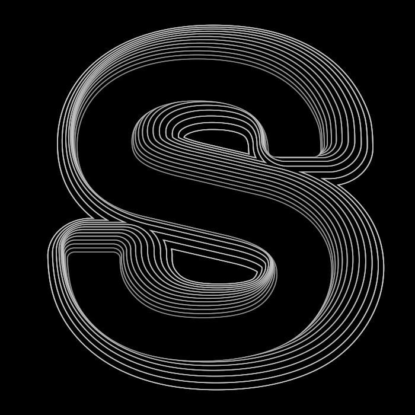

# Contour Type

Open `contour-type.fold`, open the **Contour Type** Motion composition, and select its **Contour Type** layer. Its group inputs are the artist controls; graph editing is optional.

The 700 × 700 composition runs at 24 fps for 16 seconds. The default animation repeats every eight seconds. The embedded Nimbus Sans font keeps text editable without an external font dependency.

## Controls

| Section | Controls | Use |
| --- | --- | --- |
| Text | Text, Type size, Width | Replace the letter or word. Type size is in pixels; Width stretches horizontally. Text remains centered when changed. |
| Contours | Line count, Line spacing, Line width | Use an integer count from 1 to 24. Spacing and width are in pixels. |
| Animation | Loop duration, Phase, Line stagger | Duration is seconds per cycle. Phase scrubs the cycle; stagger offsets each contour in cycles. |
| Animation | Wave depth, Orbit amount | Wave depth changes contour expansion; orbit moves successive contours around the source. Set both to zero for a static result. |
| Appearance | Trail fade, Line color, Background | Fade dims successive lines. Background also supplies the interior paint used to separate contours. |

For a word, reduce Type size. A verified **FOLD** variation used size 170, Width 1, eight lines, spacing 4, a four-second loop, Wave depth 32, and Orbit amount 14. Arbitrary strings are centered, but do not automatically fit the canvas. Dense or large settings can overlap or extend beyond the frame.

## Construction and verification

One embedded-font text source feeds an aligned, centered graph. Ordered pairs of broad line-color strokes and narrower background-color strokes create the contour bands. Native expressions vary their widths and positions with exact evaluation time and a stagger per contour. All internals are inside one reusable group; edits to the layer's inputs affect that instance.

This is a contour-echo interpretation of the supplied animated S. The reference's sharp traveling steps are not reproduced exactly: the running public Motion tools do not expose text contour conversion, offset, or trim. The authoring probe found that Path Points rejects text with `path target must contain a path`.

Rendered S at 0, 2, 4, 6, and 8 seconds, and both sides of the eight-second wrap; the 700 × 700 frames at 0 and 8 seconds were pixel-identical. Alternate text, count, spacing, size, and duration were rendered in the private candidate before restoring S. Representative 600 × 600 renders took approximately 0.13–0.29 seconds including observation work; continuous 24 fps playback is unverified. The saved project was verified through MCP state, without reopening. Mouse interaction and normal/narrow inspector layout remain unverified because the screenshot portal timed out awaiting permission.
