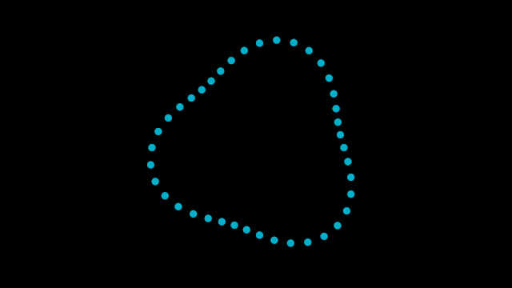

# Rust Orbit

Open [fold-rust-orbit.fold](fold-rust-orbit.fold) and select **Rust Orbit** in the Project panel. The 640×360, 24 fps Composition owns the **Orbit dots** layer and its editable MoGraph source. The project was updated through public agent transactions to the current Composition/layer structure.

- Expand **Orbit dots** in Composition's **Track view**. **Radius** and **Speed** appear underneath it, with Bézier keys at 0 and 4 seconds. Both keys retain the original values (120 and 0.1), preserving the existing motion.
- Select the layer or parameter, move the playhead, and use **Insert keyframe (I)** to add a key. Switch the same panel to **Curve Editor** to edit key time/value and tangents; selecting a parameter isolates its curve. Undo/redo applies to these edits.
- Select **Orbit dots** to follow its graph in Network. **Radius** and **Speed** remain published on the Rust Orbit group. Speed is revolutions per second; zero holds the distribution still.
- **Linear Points → Count** changes the number of dots. The Rust source redistributes them using `index / count`.
- Enter **Rust Orbit**, then select **Rust Wrangle** to edit its inline source. **Create Controls** discovers literal `chf/chv/chc/chb` calls; **Apply** compiles the draft without rebuilding or restarting Fold. Existing channels and animation are retained.
- The Ellipse and its Fill remain native editable nodes. Copy to Points consumes the generated positions; the scene transform places the result at the composition center.

The source adds a three-lobed radius variation and writes a numeric `phase` attribute. Its channel references and time are live; no animation frames are baked. The 5-second document is a half revolution at the default Speed 0.1; the complete motion period is 10 seconds.

Runtime compilation currently requires Linux `prlimit`, `rustc`, and the `wasm32-unknown-unknown` target (`rustup target add wasm32-unknown-unknown`). Execution uses Fold's bounded Wasm interface. This first version edits element translation, color, opacity and numeric attributes; topology and neighbor queries remain native-node operations.

The [executable public-tool example](../skills/fold/scripts/wrangle.py) builds this setup in an isolated session and verifies control changes, failed proposals, hot source edits, undo and out-of-order rendering. [Phase 45](../docs/phase-45.md) records validation and runtime measurements.

Verification (2026-10-07): migrated/source renders match at 0, 1 and 4 seconds. The `composition_animation_ui` native test loads this exact file, inserts keys through Composition, switches views, drags key time/value, verifies changed artwork, then tests undo/redo and save/reopen in a temporary copy. The checked-in demo retains the original appearance. Both views were inspected at normal/narrow widths. These tests inject ImGui events; operating-system mouse dragging remains unverified.
