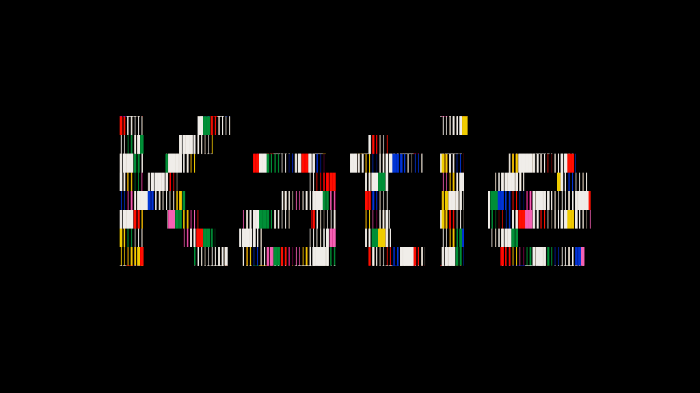

# Katie — Chromatic Bars

Open [katie-chromatic-bars.fold](katie-chromatic-bars.fold), then select **Katie — Chromatic Bars** in Motion. This project copy also preserves the earlier Rust Orbit composition.

The [reference GIF](https://mir-s3-cdn-cf.behance.net/project_modules/1400/43c43d189603701.65af4708e9e7a.gif) uses block-shaped lettering filled with changing narrow vertical bars. This version adapts that treatment to editable “Katie” text: a sampled text silhouette masks 3,240 independently animated bars in a cream/blue/orange/pink/green/yellow palette.

## Controls

| Select | Customize |
| --- | --- |
| **Katie • edit text** → **Katie Text** source | Text, Font Size, alignment and line spacing. The hidden source remains the live mask; leave its visibility off. |
| Its **Stepped Text Silhouette** modifier | Stroke Expansion in X/Y; Silhouette Detail (sampling size). |
| **Chromatic Bars • effect controls** → **Chromatic Bars** modifier | Bar Spacing, Row Height, Minimum Width, Width Contrast, Row Fill. |
| Modifier’s **Motion** section | Loop Seconds, Wave Density, Color Changes / Second, Variation Seed. |
| Modifier’s **Palette** section | Six independent colors. |
| **Background** | Background Fill color. |

The composition is 1400×788 at 30 fps, eight seconds long. The default four-second animation repeats twice. Increasing Loop Seconds slows the width wave; Color Changes / Second controls the stepped palette refresh separately. Zero refresh holds the palette. Minimum Width prevents the narrow bars disappearing; larger Width Contrast leaves more thin bars between the wide bands. Row Fill below one adds horizontal gaps.

The fixed bar grid has 180 columns and 18 rows. Very long text or extreme spacing changes can exceed its coverage; reduce Font Size or increase Bar Spacing/Row Height. Silhouette Detail and Row Height are separate artistic controls; their defaults align the stepped glyph rows with the bar bands.

Enter the Chromatic Bars group to inspect its Rust Wrangle. It computes per-bar positions, widths and colors; native instances and Set Scale render the bars. Native text shaping, masks and groups retain the editable construction. No frames are baked. Runtime Rust compilation needs the toolchain described in [phase 45](../docs/phase-45.md).

The optimized runtime preserves this artwork without changing its graph. Full-resolution release profiling averages 32.36 ms to display-ready across 119 warm frames (P95 37.24 ms); uninterrupted 30 fps is not guaranteed. See [performance evidence and next steps](../docs/phase-46-motion-performance.md).

## Verified

Built and saved through MCP in the running desktop. Rendered at 0, 0.5, 1, 2, 3 and 4 seconds; 0 and 4 match exactly, while 0 and 1 differ. Changing Text to “Katie!” and increasing Minimum Width both changed the render; the intended values were restored before saving revision 32. Preview below is the API's 1024-pixel diagnostic thumbnail, not a full-resolution export.

