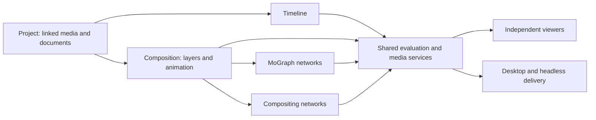
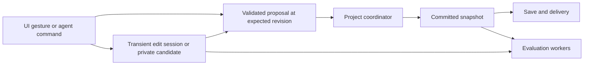
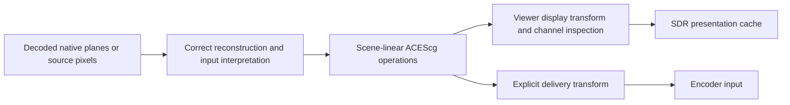
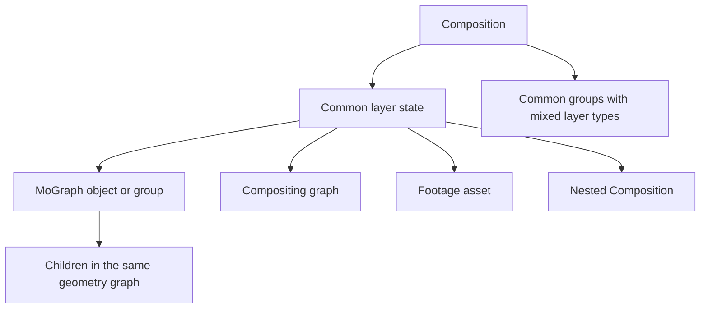

# Fold

*Product and architecture specification*

Current design | 7 October 2026

Fold joins nonlinear editing, node-based compositing, and procedural motion graphics in one editable project. Rust owns the application model, evaluation, scheduling, and GPU orchestration. Dear ImGui supplies the desktop interface through Fold's shared UI SDK.

The creative systems share project, time, animation, media, color, and execution contracts. They retain their own authoring models. A common Composition organizes layers containing MoGraph graphs, Compositing graphs, footage, and nested compositions; a Timeline assembles timed video and audio outputs into an edit.

This is a conceptual workflow, not a Rust dependency graph. Composition resolves graph outputs through capabilities; it does not import the two graph engines.

## The product promise

An editor can assemble footage, open selected clips as a Composition, add procedural typography, and return to the sequence without flattening the work. A motion designer can create content, distribute it, connect drivers and influences, and refine the same construction in its network. An agent can author and observe native artwork through public tools, then hand it to an artist with useful controls, editable graphs, animation, and source intact.

The quality of that handoff matters as much as the rendered image. A finished-looking frame does not compensate for broken controls, hidden dependencies, destructive source updates, or an inaccessible layer hierarchy.

## How to read this document

Sections 2–5 define product scope and ownership. Sections 6–13 describe execution and creative systems. Sections 14–16 define interaction and extension contracts. Sections 17–20 define the roadmap, acceptance, decisions, and source traceability. This preserves the original proposal's progression while replacing its initial-build assumptions.

This document is the **product specification and design rules**. [Current architecture](architecture.md) maps those rules to implementation and identifies discrepancies. [The development plan](../dev-plan.md) owns work status, priorities, and links to phase evidence. Explicit later user decisions recorded there take precedence until incorporated here. Historical phase notes explain decisions and measurements; their old descriptions are not current architecture.

Statements of required behavior are design contracts, not proof that every release gate passes. Current capabilities below are grounded in source inspection; limitations and proposed work are identified separately. This revision adds no new runtime or performance certification. The original `media/image*.png` illustrations are historical; the inline diagrams here replace them as current architectural guidance.

# 2 Product experience and release scope

## Who Fold serves

Prioritize editors, motion designers, and technical artists making short videos, typography, explainers, layered composites, and reusable procedural assets. Direct manipulation and network authoring are complementary views of editable work. Agent authoring is a supported workflow, with the same transaction and artist-continuation requirements as desktop editing.

The reference platform is Linux with the NVIDIA GTX 1070, 8 GB VRAM. A recorded result applies to its named build, driver, workload, resolution, backend, and display environment. Portability remains an architectural goal; this reference configuration does not establish a broader support matrix.

## The reference workflow

1. Import linked media into Project, organize bins, inspect source interpretation, and reuse existing assets.
2. Assemble a Timeline with linked video/audio, trims, cuts, track placement, and nested outputs.
3. Create a Composition from selected clips in one transaction, retaining source timing and linked timeline audio.
4. Add MoGraph and Compositing layers. Shape the artwork through direct tools, published controls, or its actual networks; animate layer and graph parameters in Composition.
5. Inspect outputs in independent viewers, choose playback modes and a monitored audio source, and retain responsive editing while preparing frames.
6. Save and reopen editable content. Deliver an explicit output and range from a committed snapshot using its output transform, independently of viewer settings.

| Area | Current capability | Remaining qualification or expansion |
| --- | --- | --- |
| Editing | Track editing, linked A/V, insert/overwrite, ripple/roll operations, nested outputs, thumbnails and waveforms | Broad native workflow and long-running A/V acceptance; advanced interchange and multicam are future scope |
| Composition | Common layers, hierarchy, timing, transforms, visibility, locking, Track view and Curve Editor | Public authoring coverage and cross-workflow hardening |
| Compositing | Image networks, named channels, EXR sequences, Shuffle and alpha-capable delivery paths | Production-node completeness, sampling parity and demanding EXR throughput remain open |
| Motion | Geometry, text, fields, instances, reusable groups, drivers, bounded Solver regions and Rust assets | Reliable public authoring across the Phase 47 benchmark; further field/GPU work requires evidence |
| Media | H.264, HEVC, ProRes and DNx video adapters; PCM/MP3/AAC/FLAC audio; PPM and OpenEXR ingest | Exact profile and hardware support remain adapter-specific; codec support is not a speed guarantee |
| Platform | Native docked desktop, persisted workspaces/preferences, CLI and live agent access, static packages | Recovery, packaging and integration gates remain open; runtime plugins and multiple native windows are deferred |

General 3D authoring, broad physics, a full DAW, collaboration, runtime plugin loading, and a marketplace are outside current delivery scope. Bounded 2D Solver tools are already in scope; they do not imply a general simulation platform. HDR scene values are supported by the color pipeline; HDR monitoring remains separate work.

# 3 Modular architecture and ownership

A package owns feature models, validation, commands, compilation, and optional panels. A capability exposes a useful operation without exposing that model. Timeline, Compositor, and Motion remain independent engines. Composition owns the shared layer document and resolves their outputs through platform capabilities.

| Boundary | Owns | Ownership rule |
| --- | --- | --- |
| Foundation and Animation | Stable identities, checked rational time, shared animation values/evaluation | No creative document schemas |
| Project | Opaque document envelopes, assets, organization, revisions, transactions, history and persistence | Provider payloads stay opaque |
| Color, Media and Native Video | Explicit color processing, source inspection, decoding, audio preparation and native transport | No panel or feature-model authority |
| Render | Shared image IR, CPU/GPU execution, resource ownership, scheduling and output processing | No Timeline, Composition or graph models |
| Platform | Registration, commands, capabilities, authoring and desktop context contracts | Connect packages without concrete feature imports |
| Composition | Common layer state, hierarchy, timing, animation and output assembly | Resolve specialized graphs through capabilities |
| Timeline, Compositor and Motion | Their own models, editors, commands and compilers | Do not import each other's engines |
| UI and App | Shared widgets/backend and concrete application assembly respectively | Panels never become render or project authorities |

Motion's reuse of the common Composition layer-state contract is deliberate. It does not make Composition the owner of Motion's graph evaluation. The application coordinates edits that affect both graph metadata and common layers in one atomic batch.

There is **one Composition type**, not separate Motion and Compositing composition types. Selecting a layer opens its actual graph. Common groups may mix graph types; a MoGraph geometry group consumes children within its own graph. Do not insert a synthetic wrapper network between an artist and those graphs. Named image inputs provide explicit cross-graph connections.

The source map and dependency-policy discrepancy are recorded in [architecture.md](architecture.md#ownership). Headless operation must remain isolated from Dear ImGui. Static Rust registrations are internal contracts, not a stable external plugin ABI.

# 4 State ownership and editing transactions

The project coordinator is the single writer of committed project state. Workers retain immutable snapshots; panels and workers submit proposed edits. Stable document/object identities survive selection, source updates, undo and persistence.

## Commands and atomic edits

An `EditBatch` declares its base revision and mutations. Generic project validation checks envelopes and references; package/application handlers validate typed meaning. A failed or stale proposal publishes nothing. Cross-document creation, placement, layer edits and graph changes form one transaction when they express one artist action.

A gesture begins an edit session, updates an evaluation-only overlay, and commits once on completion. Escape/cancel discards the overlay. Save and delivery require a `CommittedSnapshot`; an evaluation `Snapshot` cannot acquire that authority. Private agent candidates follow the same separation between observation and publication.

## Rust ownership model

Immutable document roots are shared with `Arc`. Undo and redo publish fresh revisions, so an old asynchronous proposal cannot become valid again when content resembles a previous state. History is bounded by entry count; retained-byte accounting and long-session resource acceptance remain hardening concerns.

Keep parsing, media processing, compilation, filesystem work and render submission away from UI redraw. Worker placement alone does not prove responsiveness: immediate validation and refresh paths also require measurement. Resource locks cover short bookkeeping operations, not creative evaluation or blocking I/O.

# 5 Documents, assets and capability contracts

A project holds generic document envelopes, linked assets, organization, settings and environment metadata. Each envelope identifies its provider, schema, revision, declared document/asset dependencies and opaque payload. The package interprets the payload. Project does not serialize creative Rust models directly.

| Concept | Meaning |
| --- | --- |
| Document reference | Stable document ID plus output identity and retained extension metadata |
| Asset | Linked location, fingerprint and source metadata; distinct from an authored document |
| Project item/bin | Persisted organization of asset/document references, with names and hierarchy |
| Video/audio capability | Provider-owned output metadata and compilation into shared execution contracts |
| Layer graph capability | Named image inputs and evaluation in an owning layer's exact context |
| Animation capability | Discoverable channels, values, edits and source-clock mapping without importing another package's model |
| Authoring capability | Discoverable schemas, operations, validation and observation for public tools |

Import registers linked sources without implicitly creating clips or changing delivery output. Placement chooses a destination and timing separately. A direct file drop may combine import and placement into one transaction; background work must still reject a stale destination. Sources remain in place, and duplicated placement reuses stable references.

## Nested documents and unavailable packages

Resolve nested outputs inside the same snapshot and compile them into the shared plan. Validate references and cycles before publication/evaluation. Missing providers or media must remain identifiable; unknown payloads and referenced assets survive save/reopen. Delivery must report unavailable requirements instead of silently omitting work.

## Persistence and recovery

The current `.fold` file is a versioned JSON archive; the writer emits version 3 and the loader accepts versions 1–3. Package payload schemas are separately versioned. Unknown payload bytes and extension metadata are retained. Legacy color settings remain legacy; an old file is not silently reinterpreted as ACEScg.

Save writes and syncs a same-directory temporary file before replacement, with parent-directory synchronization on Unix. A directory-sync failure means the replacement is visible but durability was not confirmed. This is not a complete autosave/recovery system; recovery policy, interruption coverage and packaging remain release gates.

Workspace layout, viewer bindings/transports and application preferences live outside authored content. Project defaults and the project Cache-folder setting are authored settings. That folder currently reserves a location for future Cache-node output; setting it does not create a disk render cache.

General preservation of unknown data does not authorize automatic creative-model conversion. The common-Composition transition explicitly rejected legacy-project adoption shims; affected demonstration artifacts were updated deliberately.

# 6 One shared render and evaluation engine

Rendering answers a demand for a document output at exact time, dimensions and explicit viewing/output conditions. Creative compilers interpret their own models and produce shared image work; audio retains its own range-based plan. Nested providers append graph work rather than synchronously rendering intermediate movies.

## Three representations with different jobs

The **authoring model** retains editable intent. The **render IR** expresses image operations and dependencies. **Execution** chooses decoding, CPU/GPU evaluation, retained resources, admission and synchronization. These are responsibilities, not a claim that a universal optimizer or tiled physical-plan system has been completed.

Current execution includes CPU reference evaluation, wgpu image/vector processing, bounded source preparation, shared scheduling, caches and selective pass fusion. Supported GPU work stays resident through working evaluation and viewer display conversion. CPU geometry preparation, decoding fallbacks and delivery readback remain explicit costs.

Preview, export and headless rendering share scene compilation and color semantics. Preview may request a smaller visible region or resolution. Delivery pins committed state and explicit output settings. Compare equal requests before encoding; a small cached viewer is not evidence of full-resolution render throughput.

Cancellation retires obsolete queued work and cooperatively stops CPU work. Submitted GPU work retains its resources until completion even if its consumer disappears. Generation checks prevent an old seek, edit or source request from publishing over the current demand.

# 7 Frames, color and GPU resource ownership

## A frame is a typed resource

Carry dimensions, timing, pixel/plane layout, bit depth, color interpretation, alpha convention, storage and readiness with pixels. Native YUV planes, float working images and display-ready textures have different contracts. Source metadata and user input-color assignment are distinct records.

New projects use scene-linear premultiplied **ACEScg**, with pinned OCIO 2.4.2 and ACES 1.3 Studio config 2.2.0. Validated external configurations are explicit, bounded resource packages. Missing or changed resources produce errors rather than an implicit global-config fallback.

## Conversions and compositing

Preserve finite negative and above-one RGB where supported by working operations. Alpha remains explicit. Nonlinear color processing uses straight RGB as required, then restores premultiplication; display/output transforms are applied once. Channel inspection and any future viewer exposure/look controls must not accidentally alter export. Current viewing uses fixed sRGB/ACES SDR Video under the accepted input/output-only color UI decision; editable per-viewer OCIO display/view/look selectors are not shipped.

Current core GPU working images use **RGBA32F**; selected textured resources may use RGBA16F or RGBA32F. The old proposal's “normally RGBA16F” is not the implemented blanket storage rule. Precision changes require measured equivalence, memory and throughput evidence.

## GPU ownership and interoperability

The shared render Host owns device/queue access, accounting, pooled images and completion-aware lifetimes. The default engine budget is 1 GiB on the reference configuration, with the 256 MiB presentation-cache limit accounted within shared GPU ownership. Decoder/driver allocations and process RSS are measured separately; a logical budget is not a total physical-memory guarantee.

The native-video path has explicit device identity, readiness and ownership contracts. On qualified NVIDIA/Linux paths it can copy decoded surfaces GPU-locally into engine-owned resources. Hardware decode, GPU rendering and hardware encode are separate capabilities. Keep verified fallbacks and report copies; do not infer portable zero-copy from one successful path.

# 8 Scheduling, caching and delivery policies

## Schedule for the current user action

Bound per-consumer requests and source preparation. Give current interactive demands and monitored audio timely service while preserving fair export and background progress. Two viewers may share matching work while retaining independent cancellation, clocks and publication generations.

Each viewer offers **Real-time** and **Every-frame** playback. Real-time uses the monitored audio clock when applicable, otherwise its monotonic clock, and may skip video to preserve time. Every-frame advances with consecutive presented frames, slows when necessary, never exceeds document fps and remains muted. Provider metadata supplies defaults; workspace state retains overrides.

Hold the last valid image while preparing its replacement. Ordinary frame preparation must not blank the viewer or introduce flashing loading indicators. Requested time and displayed-frame identity remain separate so held images cannot misdirect overlays or conceal obsolete publication.

## Cache by meaning rather than location

Separate decoded-source, geometry, intermediate and presentation caches. Keys reflect content/output identity, exact time, dimensions/region, quality, channels and relevant color processing. Organization or layout changes should not invalidate unrelated scene work.

Presentation stores viewport-sized, display-transformed SDR images; overlays are drawn afterward. Zoom-aware requests retain the visible crop at an appropriate scale. Quality-gated BC7 compresses suitable retained frames; RGBA8 remains the immediate/fallback path. Current presentation must not wait for compression. Displayed and in-flight resources remain protected from eviction.

Prepared review ranges are bounded by available cache space. Cache bars report actual matching coverage and eviction. Explicit cached review is useful but does not satisfy uncached playback acceptance. Persistent general-purpose disk rendering and proxy generation require separate implementation and measurement. The existing **Image Bake** tool is a narrower, explicit source-texture preparation workflow: it builds local `.foldtex` resources with mipmaps, invalidation and rebuild/clear/cancel operations. Its compact BC7 option is lossy SDR; Float16 preserves HDR/negative values. It is separate from both the viewer cache and the reserved future Cache-node folder.

## Reproducible delivery

Delivery chooses its document/output, range, output transform and codec independently of panel focus and viewer transports. It evaluates a committed snapshot from scene data, never from the 8-bit presentation cache. The current implementation includes explicit output rendering and alpha-capable ProRes delivery; Phase 20 still owns complete reproducibility, preflight, encoding and packaging acceptance.

Record the environment and source/configuration identities needed to explain results. Validate encoded timing, metadata and audio separately from pre-encode pixel comparison. Cancellation and failure must not leave a misleading completed output.

# 9 Exact time and the audio engine

## Time mapping

Use checked rational time for frame boundaries, durations, source offsets and nested clocks. Ranges are half-open. Display rounding and timecode formatting do not change stored time. A layer's source clock remains distinct from its trimmed visible range; Composition animation and graph parameters must resolve through the owning context.

Current media adapters validate their supported timing profiles, including CFR requirements. Exact rational arithmetic does not imply arbitrary VFR support. Reject unsupported interpretations rather than quietly coercing source timing.

## Audio execution contract

Audio compilation produces bounded sample-range work. Workers prepare disk-backed stereo 48 kHz float PCM; the device callback consumes a bounded ring rather than decoding or taking a project lock. Authored source offsets and output-range clipping must agree across playback and delivery.

One viewer is explicitly monitored at a time. Creating, focusing or playing another viewer does not steal monitoring; closing the monitor clears it. Unmonitored viewers retain independent clocks. Every-frame playback is muted. Audio monitoring, editor selection and export output are separate state.

Long-loop drift, monitor handover, failure/shutdown and mixed-viewer behavior remain integration acceptance obligations even where focused tests and earlier native benchmarks pass.

# 10 Timeline and compositor behavior

## Timeline authoring

Timeline owns sequences, video/audio tracks, clips, source mapping and editing operations. Linked A/V survives appropriate clip edits and placement. The current editor provides multi-selection, snapping, split/lift, insert/overwrite, ripple delete, ripple/roll trim, track creation, thumbnails and waveforms through transactional commands.

A compact toolbar and track headers leave the edit surface dominant. Placement previews identify destination/time and invalid drops; Escape cancels. Opening a nested clip navigates to its source at mapped time and supports return navigation. Timeline output duration may follow content or use an explicit boundary without trimming authored clips.

## Compositor authoring

Compositing networks own image processing, named channels, source reads and graph-specific parameters. Current work includes multilayer EXR/sequence support and Shuffle, alongside transforms, grade, blur, masks and merge. Complete production-node behavior and EXR performance remain tracked in Phase 23; a registered node is not proof of production completeness.

Merge A is foreground; B is background/main pipe. A background-only Merge passes B through until A is connected, and a mask controls A's contribution. Compositing cards use compact top-down flow, while Motion keeps left-to-right flow. Shared interactions include disconnect, rewiring, contextual creation and compatible pipe insertion, with provider validation and atomic undo.

## Moving between creative workspaces

Create Composition preserves timing and references and retains linked timeline audio. Composition owns the common stack; Network shows the selected layer's actual graph. Navigating or focusing an editor must not silently retarget delivery or another viewer. Returning to an edit preserves editable source relationships rather than inserting a rendered substitute.

# 11 Procedural motion graphics evaluation

## Geometry and attributes

Motion owns typed geometry, text, paths, points, fields, instances and procedural graphs. Stable element identity and consumer domain are part of the meaning of an operation. A value evaluated for an object, copy, glyph or path point must use the intended domain; visually similar output does not excuse an incorrect target scope.

Media Texture and image-driven Motion support referenced images/video, textured cards and deformable grids, explicit source-time mapping and GPU image sampling. Image fields have defined consumers; they do not imply arbitrary CPU Math/Wrangle pixel access.

Shared geometry plus per-copy transforms/paint avoids duplicating every path for every instance. The GPU vector path prepares coverage and ordered compositing while preserving fill/stroke order, masks, alpha and working color. CPU preparation and bounded exceptional fallbacks remain explicit.

## Fields and instances

Separate content, distribution, drivers, influence and response. Duplicator owns distribution and per-copy inputs; a wave or palette remains an independently editable tool. Time-dependent fields and stagger sample the exact intended source time, including animated parameters through groups.

Reusable groups expose typed ports, defaults and control metadata. Convenience tools construct the same native nodes and links an artist can inspect. Parameters, random seeds and explicit dependencies determine output; panel focus and evaluation request order must not become hidden inputs.

## Evaluation rules

Stateless motion supports arbitrary-time evaluation. Stateful work uses explicit Solver regions with an initial state, exact fixed step and bounded replay/checkpoint behavior. Changing relevant inputs invalidates dependent state. Never treat stateful simulation as an unexplained exception to deterministic seeking.

Rust Wrangles provide bounded programmable evaluation where needed. Live Rust assets construct retained native graphs at author time; these are distinct mechanisms. Neither implies that arbitrary Rust or all Motion fields execute on the GPU. A more unified typed expression IR for field math, bindings and snippets remains a design direction; further typed-field lowering/fusion requires its own implementation and performance evidence.

# 12 One Composition with explicit visual rules

The common Composition is the artist's layer and animation container. Its front-to-back stack, parent relationships, visibility, lock, opacity, transforms, timing and animation have one owner. Graphs retain their specialized internal semantics.

## Coordinates and effect placement

Keep layer transforms and source-local time distinct from graph-internal transforms and clocks. Common opacity belongs to the layer; graph parameters remain provider-owned. Locks apply through hierarchy. Editing a graph object that owns a layer must update both representations atomically, not leave two competing values.

Graph output is evaluated in its owning Composition context through explicit capabilities. MoGraph groups consume their own graph children; use common layer groups for independently typed layers. Named image inputs connect processing chains without hiding source relationships.

## Reusable effects, timing and format

Effects and transitions are editable graph definitions with published inputs and controls. The same definition can appear as a node or an ordered clip/layer effect. Compositing networks and mixed Compositions may implement the contract. Instances retain their own values and animation. Image effects receive Source; transitions receive Outgoing, Incoming and an explicit duration context. Input means invocation-supplied media; Image Reference means a retained typed document output. Keep those concepts distinct.

A transition's normalized progress controls choreography without changing footage speed. Use true premultiplied RGBA interpolation for dissolve. General Timing, Curve and intro/hold/outro primitives support transitions, templates and adjustments; periodic behavior remains explicit. Adjustment layers process only the lower content in their defined host scope.

Motion layout uses logical scene units independent of output pixels. HD-to-4K changes raster density without rewriting geometry or animation. Aspect changes choose Fit, Fill or Responsive framing; anchors and relative measurements opt content into adaptive layout. Existing explicit image transforms remain alongside Relative Transform. Full destination format is separate from preview dimensions, so preview quality cannot move a wipe or change layout. Pixel-fixed distances require explicit conversion from output pixels.

Image effects use shared resident GPU resources. Live WGSL authoring exposes named images and controls with explicit interface migration, worker compilation, diagnostics and revision-safe publication. Rendered Motion uses this same image path; arbitrary Motion geometry/field execution is a separate performance concern. [Phase 57](phase-57.md) records implementation status and measured limits; these product contracts do not certify its unfinished acceptance items.

## Renderer boundaries

The shipped model is 2D and image-oriented. Vector geometry, footage and graph outputs reach the shared image execution path. A general spatial scene, depth-tested planes, meshes, cameras and a Bevy adapter are future proposals, not a parallel implemented renderer or an existing release requirement.

# 13 Motion controls and direct authoring

## Property stacks explain the result

Basic motion design should follow **Content → Distribution → Driver → Influence → Response**. Direct tools, compact parameter menus, exposed group inputs and the graph operate on the same editable construction. Keep the authored value, animation/driven state and actual target understandable; a complete universal property-stack inspector remains a design direction, not an implemented SDK claim.

Composition has exactly **Track view** and **Curve Editor** for animation. Keyed layer and graph parameters appear beneath their owning layer. Network remains graph editing. The retired standalone Animation/MoGraph authoring windows and Network Animation toggles are not alternative workflows to restore.

## Reusable assets and live Rust

Live Rust authoring compiles bounded source into native group definitions, stable controls and graph instances. Artist values, keyframes and connections survive compatible source updates. Incompatible interfaces require explicit migration; conflicting internal artist edits must be reported rather than overwritten.

Portable bundles retain native definitions, source and embedded dependencies such as fonts. External media/documents remain explicit dependencies. Coordinated migrations across multiple source-owned definitions can still reject atomically; general reconciliation is not complete.

Public MCP/CLI authoring supports discovery, bounded jobs, private candidates, observation and transaction commit. Judge success by rendered motion over a full cycle, meaningful controls, subsequent artist edits and save/reopen. Phase 56's accepted Rust-asset trial does not close Phase 47's separate reliability benchmark or its proposed declarative construction/reconciliation work.

## Animation and simulation are different contracts

Animation evaluates authored channels and expressions at requested time. Solver evaluates explicit state transitions. Reusable tools must expose the distinction and useful controls; broad collisions, continuous emission and general physics are not implied by the shipped bounded particle/Solver tools.

# 14 Desktop UI and workspace layout

Fold uses one native window with internal docking and multiple editor/viewer instances. Saved workspaces and presets restore panel layout and context separately from project content. Playback restores paused. Application preferences, project defaults, document settings, source interpretation and delivery settings retain distinct scopes.

## Navigation and feedback

Editors have explicit document targets. The default workspace places Viewer above tabbed Timeline/Composition on the left, tabbed Inspector/Project/Delivery above Network on the right, with primary contexts in group A. A group has at most one editor of each type. Opening a document or explicitly clicking an authoring tab carries linked viewers and the appropriate Network context to that source; merely changing keyboard focus does not. Nested navigation opens the matching peer surface in the same group without replacing the source panel, and Back retains exact parent time and selection. Unlinked viewers retain their chosen output. Inspectors follow group selection independently and may lock their target.

Each viewer owns its transport, review range, loop, mode, resolution and displayed-frame context. Two viewers can show the same document at different times. Shared caches do not imply shared clocks. Navigation through a nested graph preserves parent stack, selection and exact source time.

Project Settings controls new-item defaults, project color and the reserved Cache folder. A common item-settings window targets a specific document; Apply is one undoable edit and Cancel changes nothing. The same document opened through Composition and Network retains the same settings.

## Design and interaction requirements

Apply the [Fold UI skill](../.agents/skills/fold-ui/SKILL.md): quiet chrome, readable labels, compact toolbars, contextual depth, semantic colors/icons, numeric alternatives and clear focus. Preserve artist language and useful controls at narrow widths; overflow secondary actions instead of stacking toolbar rows.

Feedback must add information. Routine edits and ordinary frame preparation do not need notifications or layout changes. Missing sources, invalid interpretation, failed jobs and degraded quality need understandable feedback. Retained images must never become authority for an unrelated edit context.

Test normal/narrow layouts and relevant DPI scales. Native captures, injected widget events, virtual-display playback and physical desktop interaction are different evidence. Full IME, screen-reader and cross-compositor accessibility support is not certified by Dear ImGui integration alone.

# 15 Shared UI components and SDK

Dear ImGui is the interaction/drawing substrate. Fold UI owns shared controls, editors, graph canvas, viewer presentation, native drop handling and backend integration. Feature packages contribute optional panels through the SDK; application logic remains Rust and mutations remain transactions.

## The central contracts

Stable `UiId` scope identifies a package, panel, document/object and property independently of display labels. `EditResponse` carries edit lifecycle so previews, one-entry commit and cancellation behave consistently. Numeric properties carry identity, units, steps, limits and reset metadata; animation channels are discovered through provider contracts.

The implemented SDK is a growing set of concrete shared components, not a completed universal `ParameterSchema` or public plugin UI protocol. Add shared abstractions for demonstrated needs. Custom trusted ImGui access remains an internal escape hatch; keep repeated drawing and interaction behavior in reusable components.

| Shared surface | Responsibility |
| --- | --- |
| Properties and inspectors | Consistent edit lifecycle, labels, units, control metadata and animation affordances |
| Timeline, Composition and curves | Shared interaction building blocks with provider-owned semantics |
| Network canvas | Navigation, ports, wires, placement and selection with feature-owned validation/presentation |
| Viewer and transport | Explicit source/time context, overlays, cache feedback and independent playback |
| Project, settings and workspace | Typed references, explicit destinations, scoped settings and persisted UI context |

UI receives presentation handles with explicit lifetime; render services own engine resources. Boundary checks currently expose direct UI dependencies that require reconciliation, as documented in architecture and the roadmap. Do not describe a failing policy check as an enforced clean boundary.

# 16 Packages, execution and compatibility

Built-in packages register document, output, command and panel contributions statically. App assembles concrete implementations. Headless CPU and GPU builds use the same providers without loading Dear ImGui panels. Native decoding, OCIO and Rust compilation may use private helpers/FFI without moving application ownership out of Rust.

## Three stability levels

Internal APIs evolve with implementation. Platform contracts between built-ins change deliberately with callers and tests. A future external SDK requires smaller versioned compatibility contracts; current Rust traits and manifests do not establish a stable cross-binary interface.

Public agent tools are a separate supported access surface. Their schemas and observations should allow artwork creation without reading implementation crates. Discoverability, limits, diagnostics, failure recovery and artist continuation are part of that surface's acceptance, not optional documentation polish.

## Execution modes

Live Rust assets and Wrangles use bounded WASM execution and compiler supervision. Source limits, memory/fuel limits, cancellation and data-only construction are explicit. This limited authoring/runtime mechanism is not a runtime plugin system with arbitrary host imports or UI callbacks.

Runtime native plugins, general WASM extensions, hot reload, multiwindow and remote rendering remain future work. Each needs explicit ownership, lifecycle, compatibility and failure contracts before implementation. Continue packaging pinned media/color resources and testing relocation; codec distribution and clean-machine coverage remain release work.

# 17 Roadmap and integration gates

The foundation is implemented. The next roadmap closes specific acceptance gaps around the current creative workflow rather than rebuilding the original A–F prototype sequence. [dev-plan.md](../dev-plan.md#current-roadmap) owns task status and phase evidence; phase numbers remain stable.

| Gate | Work remaining | Exit evidence |
| --- | --- | --- |
| A Current-baseline reconciliation | Reconcile old open tasks with later implementations, public schema coverage and dependency policy | Each surviving obligation has a named owner and evidence; completed portions are not implemented twice |
| B Correctness and production compositing | Resolve the recorded nearest-transform CPU/GPU discrepancy and remaining Phase 23 node/channel semantics | Matched output fixtures, alpha/channel correctness, editable graphs and documented limits |
| C Sustained performance | Qualify demanding EXR decoding and cold desktop cache-fill/scheduling; preserve earlier mixed-viewer performance | Full-resolution cold/uncached and warm measurements, resource peaks, fair export and actual desktop pacing |
| D Delivery and recovery | Complete Phases 20–21: preflight, reproducibility, encoded timing/color/audio, persistence/failure and packaging | End-to-end desktop/CLI workflow, cancellation/recovery and reference-machine integration checkpoint |
| E Public authoring reliability | Complete Phase 47's own benchmark, reconcile Phase 56 coverage and evaluate declarative artist-edit reconciliation | Required independent trials, native editability, controls, full-cycle observation and bounded operation cost |
| F Qualified expansion | Additional codecs/platforms, HDR monitoring, spatial work, plugins and field/GPU optimization when justified | Separate scoped proposal and correctness/performance/compatibility gate |

A–E can progress in focused slices; correctness fixes precede performance claims for affected workloads. This order is a planning default, not authorization for every future proposal. Preserve accepted phase evidence and recorded user scope decisions. A successful newer feature does not automatically close an older integration gate.

## Resolve remaining risks with matched evidence

For performance work, identify the failing stage before changing architecture. Distinguish source decode, geometry/field generation, scheduling, GPU work, display conversion, transfer and physical presentation. For authoring work, prove discovery → construct → observe → revise → commit → artist continuation. For recovery, test failure paths against actual persisted content, not only successful round trips.

## Workspace organization

The workspace now includes Foundation, Animation, Color, Native Video, Project, Media, Render, Platform, UI, Timeline, Compositor, Composition, Motion and App. Ownership—not an initial ten-crate sketch—governs future changes. Split modules where responsibility or compilation boundaries justify it; avoid speculative service layers.

# 18 Acceptance criteria and measurement

Acceptance combines model correctness, visible workflow, persistence and measured execution. Automated tests, artist acceptance and hardware measurements answer different questions and must be reported separately.

| Area | Required evidence |
| --- | --- |
| Reference workflow | Project import/organization → Timeline → mixed Composition → animation → independent viewers → save/reopen → desktop and CLI delivery |
| Editing | Atomic cross-document edits, one undo entry per gesture, cancellation, locks and stale proposal rejection |
| Native authoring | Actual hierarchy/graphs, useful controls and continued artist editing; image parity alone is insufficient |
| Persistence | Unknown payloads/extensions, legacy color, referenced assets and interruption/recovery behavior |
| Time and audio | Exact nested clocks and half-open ranges, valid output clipping, explicit supported source timing and long-loop drift checks |
| Color and rendering | Matched CPU/GPU and preview/export requests, signed/HDR values, alpha, sampling and output-transform correctness |
| Responsiveness | Input remains responsive during ingest/render/compile/export; obsolete results never publish |
| Resources | Bounded queues/cache retention, protected submitted/displayed resources, pressure recovery and shutdown |
| Public tools | Discoverable schemas, private observation, controlled commit, repeatable task success and artist handoff |

## Performance targets and evidence

Retain the declared 1080p30 two-video/title/audio target, UI frame-time P95 below 16.7 ms and warm presentation-cache seek below 100 ms for the qualified reference workload. Phases 19A–19B record successful native runs under their conditions. They do not certify every newer effect, EXR sequence or Rust asset.

Track cold/warm conditions, drops, audio underruns, input latency, queue wait, cache reuse, transfers, process/driver/logical memory and export throughput. The newer EXR uncached 24 fps target and Phase 56 cold desktop pacing remain open. Warm cached replay or renderer-only readiness cannot close those gates.

## Meaningful fixtures

Maintain fixtures for fractional timing, trim/range boundaries, nested layer/graph clocks, shared-source animation identities, alpha edges, named EXR channels, OCIO resources, missing dependencies, source updates and unknown data. Include resource pressure, cancellation, active-job shutdown and stale candidates.

Public authoring qualification must preserve its specified model, isolation, repetitions and budgets. Phase 56's accepted Sol trial is evidence for that phase; Phase 47's Luna benchmark has independent requirements. Record failures and limitations alongside successes, without silently substituting a different gate.

# 19 Design decisions and remaining questions

## Settled design rules

| Decision | Consequence |
| --- | --- |
| One common Composition; independent graph engines | Shared layers/animation, direct access to real networks, capability-based evaluation |
| Transactional single writer and immutable snapshots | Worker proposals, atomic undo, private previews and committed-only persistence/delivery |
| ACEScg with pinned OCIO | Explicit input, viewer and delivery transforms; legacy appearance preserved |
| GPU execution plus CPU reference | Measured backend equivalence, explicit precision and fallback costs |
| Independent viewers with shared resources | Per-viewer time/mode/source and one audio monitor; no duplicated unlimited budgets |
| Native procedural assets and public agent access | Editable construction and artist continuation are acceptance requirements |
| Quiet shared UI | Consistent scoped controls and compact context, not diagnostic-heavy creative panels |
| Static packages and 2D scope | Runtime plugins/spatial expansion require separate decisions |

## Decisions still requiring evidence or scope approval

Reconcile dependency policy with actual UI dependencies. Complete recovery/autosave and reproducible release packaging. Determine appropriate cold-playback/EXR fixes from measurements. Scope the proposed declarative construction and artist-edit reconciliation work separately from the accepted Rust asset implementation. Further field/GPU lowering, disk caches, HDR monitoring and additional platforms require their own proposals and acceptance.

The Linux reference platform, ACES configuration, common Composition, UI backend and Rust authoring direction are no longer unanswered initial-design questions. A repository-wide public release/license/support commitment still requires explicit release decisions; this document does not invent them.

## Principal risks and responses

Documentation drift can revive rejected workflows: keep current rules here, implementation facts in architecture, and completion evidence in the tracker. Creative breadth can outrun reliability: prioritize the integrated workflow and preserve open gates. Rendering and native interop can hide quality or resource regressions: compare matched requests and track actual lifetimes. Generated artwork can become unmaintainable: require native editability and safe source revision, not just a pleasing export.

# 20 Source traceability and maintenance

This revision is grounded in repository source and the active plan as inspected on 7 October 2026. It replaces the initial consultation-based proposal as current guidance. The consultations and original raster diagrams remain historical inputs; they are not implementation evidence.

| Subject | Current source and decision/evidence references |
| --- | --- |
| Ownership, persistence and execution | [Implementation architecture](architecture.md), [workspace crates](../Cargo.toml), [project coordinator](../crates/project/src/coordinator.rs), [archive](../crates/project/src/persistence.rs) |
| Composition and integrated animation | [Composition model](../crates/composition/src/model.rs), [layer graph contract](../crates/platform/src/layer_graph.rs), [Phase 51/51a](phase-51.md) |
| Color and GPU/native media | [Color runtime](../crates/color/src/lib.rs), [GPU renderer](../crates/render/src/gpu/mod.rs), [Phase 18A](phase-18A.md) |
| Playback, ownership and performance | [Workspace contracts](../crates/platform/src/workspace.rs), [preview worker](../crates/app/src/preview_worker.rs), [Phase 19A](phase-19A.md), [Phase 19B](phase-19B.md) |
| UI and workflows | [Fold UI skill](../.agents/skills/fold-ui/SKILL.md), [Timeline phase](phase-52-timeline.md), [development plan](../dev-plan.md) |
| Live Rust and agent reliability | [Rust asset implementation](../crates/motion/src/program/mod.rs), [Phase 56](phase-56-live-rust-assets.md), [Phase 47 benchmark](phase-47-reference-benchmark.md) |

When changing a product rule, update the relevant section and its implementation/roadmap references together. Preserve historical phase results as dated evidence. When code contradicts a rule, record the discrepancy rather than silently treating either a stale document or an implementation accident as a new design decision.
