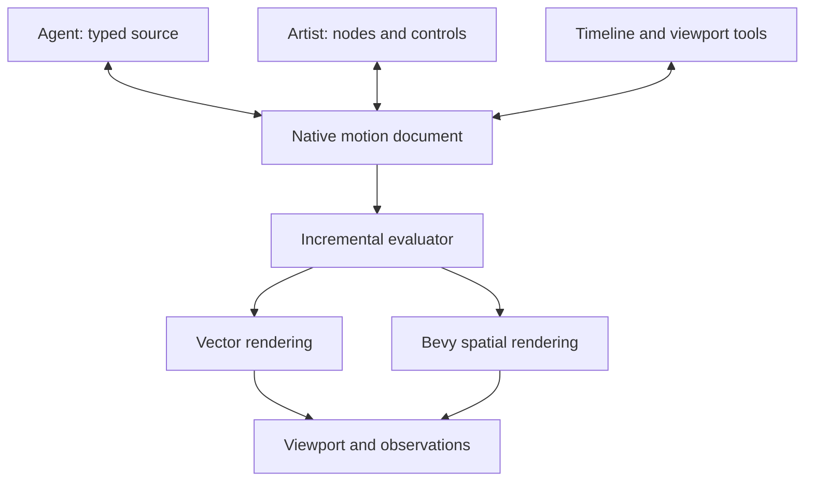
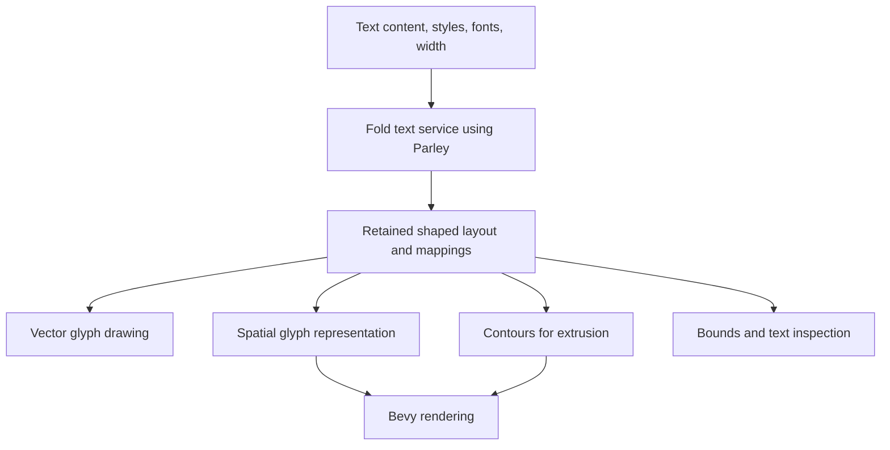

# Fold Motion — Agent-Native Procedural Animation

> **Implementation authority — 8 October 2026.** The [Motion System Rewrite Plan](Motion_System_Rewrite_Plan.md) adopts this target design and controls sequencing/status. The user requires complete replacement: its removal policy overrides §14.5’s recommendation to retain the existing engine and §5.1’s optional retention of Rust builders. Old motion/MCP protocols will not receive compatibility shims. No implementation acceptance is implied.
## Revised architecture and node-set proposal

**Date:** 8 October 2026  
**Status:** Proposed architecture and product direction. APIs, syntax, node names, and performance numbers below are design proposals, not implemented behavior or delivery commitments.  
**Basis:** The supplied `Fold_Unified_Motion_Proposal.md` and the decisions agreed in this conversation.

## 1. Product intent

Fold is a procedural motion-design application for typography, vector artwork, repeated forms, image cards, animated meshes, and cameras. It supports 2D, 2.5D, and 3D through one construction model.

**An agent authors a typed construction. An artist edits that same construction through nodes, controls, viewport tools, and animation tracks. Either can continue the other's work.**

The experience combines the approachable controls of a motion-design tool with explicit geometry streams and attributes. Everyday tasks should require a few meaningful operations. Deeper control should remain available without rebuilding the scene in another system.

The core product requirements are:

- Fast, incremental authoring with visual feedback after each valid change.
- Artist-readable constructions with meaningful names, groups, exposed controls, and stable layout.
- Native text and vectors throughout ordinary editing, with deliberate conversion to spatial geometry.
- One animation model for direct controls, fields, expressions, and timeline tracks.
- Deterministic arbitrary-time evaluation for seeking, previews, reference matching, and export.
- Structured inspection that lets agents diagnose the scene as well as see its rendered image.
- Reusable assets that remain editable and versionable.
- Bevy, Parley, and USD integrated behind boundaries owned by Fold.

Image-processing composition remains a separate feature. Motion publishes renderable scenes and image outputs through a feature-neutral interface; it does not absorb the application's entire compositor.

## 2. Principal decisions

| Area | Proposed decision | Reason |
| --- | --- | --- |
| Authoritative project state | A versioned native motion document | Code, nodes, controls, and the timeline can edit the same objects. |
| Agent authoring | A small declarative, typed motion language | Fast validation and a defined round trip between text and native constructions. |
| Implementation | Rust for the document, evaluator, operations, and integrations | One implementation can serve native editing, agent tools, and rendering. |
| Evaluation | A custom incremental evaluator with a typed field intermediate representation | Fold controls geometry semantics, invalidation, timing, GPU work, and diagnostics. |
| Spatial rendering | Selected Bevy plugins behind a Fold adapter | Reuse rendering infrastructure while preserving Fold's document and time model. |
| Text layout | Parley behind a Fold text service | A single shaping and layout result can feed vector display, spatial display, and inspection. |
| Vector rendering | A dedicated coverage backend, initially evaluating the Vello family | Text, paths, strokes, fills, and clipping need explicit quality qualification. |
| USD | Asset composition and interchange behind an adapter | Keep studio-scale scene exchange available without exposing USD concepts in ordinary authoring. |
| Artist workflow | A compact default palette with deeper operations on demand | Make common designs easy while retaining explicit procedural control. |
| Agent workflow | Discover, inspect, propose, observe, revise, apply | Make visual correction and artist continuation first-class capabilities. |

The initial node proposal contains **28 artist-facing operations and 22 foundation operations**, plus **8 later candidates**. These are vocabulary groups, not a requirement to implement 50 complete operations before proving the architecture.

## 3. System architecture and ownership

### 3.1 One document, several editing surfaces



The document contains operation instances, typed connections, parameters, expressions, tracks, named outputs, reusable asset definitions, asset instances, and stable IDs. Editor layout, annotations, and collapsed states are stored as presentation metadata attached to those IDs.

The authoring graph preserves the user's construction. The execution plan may combine operations, share intermediate results, or change scheduling. It retains provenance back to source ranges, nodes, controls, and tracks.

A saved construction must evaluate without executing arbitrary authoring scripts. The native document is sufficient to reproduce supported results with the required operation versions and assets.

The saved project records the document schema version, operation versions, asset/font content references, clock settings, seed policy, and relevant rendering settings. Asset definitions and instance overrides remain distinct. Derived buffers, acceleration structures, compiled kernels, and renderer worlds are recoverable caches. An export package may embed the required permitted assets; missing dependencies remain explicit on reopen.

### 3.2 Responsibility boundaries

| Subsystem | Owns | Boundary |
| --- | --- | --- |
| Document service | Identity, revisions, transactions, undo, asset definitions, serialization | Does not contain transient renderer state. |
| Language service | Parsing, type inference, diagnostics, formatting, source-to-document mapping | Emits validated document transactions. |
| Operation registry | Contracts, versions, defaults, controls, examples, capability declarations | Supplies both artist and agent interfaces. |
| Evaluator | Dependency compilation, time evaluation, caches, cancellation, CPU/GPU execution | Consumes immutable document snapshots. |
| Text service | Font resolution, shaping, layout, text selection mappings, outline access | Uses Parley and related libraries through a Fold adapter. |
| Render coordinator | GPU ownership policy, render requests, resource budgets, completion | Coordinates vector and spatial rendering. |
| Bevy adapter | Translation of evaluated spatial results into retained render resources | Runtime ECS state is reconstructible. |
| USD adapter | Supported imports, scene composition, export, correspondence metadata | Does not define Fold's ordinary node or field semantics. |
| Observation service | Frames, crops, clips, measurements, diagnostics, provenance | Observations are bound to immutable revisions and explicit times. |

These are conceptual boundaries; they need not become one crate each immediately. Dependency direction matters more than crate count.

### 3.3 One operation definition

Each public operation definition should supply:

- Stable operation key and semantic version.
- Typed inputs and outputs, defaults, units, spaces, and valid ranges.
- Supported geometry kinds and attribute domains.
- Missing-data, selection, interpolation, and identity policies.
- Uniform, per-element, time-dependent, and topology-changing behavior.
- CPU/GPU capability declarations and relevant cost classifications.
- Inspector controls, socket names, viewport handles, and concise help.
- Tested examples and diagnostic identifiers.
- Migration behavior when its serialized contract changes.

Generate language declarations, tool schemas, documentation, and node metadata from this registry. Generate scaffolding for tests; separately write meaningful behavioral and visual tests. A single schema prevents API drift, but does not prove implementation correctness.

## 4. The typed construction model

### 4.1 Values, signals, fields, and attributes

| Concept | Proposed meaning | Example |
| --- | --- | --- |
| Value | A typed datum with declared units or encoding where relevant | Color, angle, distance, duration, rotation, font reference |
| Signal | A value sampled at an explicit time | Animated opacity or camera position |
| Field | A typed expression evaluated over a declared domain or position context, optionally including time | Per-instance scale driven by a radial influence |
| Attribute | A materialized typed value stored on a declared domain | Point position or instance color |
| Geometry | An immutable logical collection of compatible or mixed geometry parts and attributes | Text, paths, shapes, meshes, points, instances |
| Placement | Geometry plus its presentation space, transform, and ordering rules | Screen title or world-space mesh |
| Scene | Placements, camera references, lights, and presentation settings | A named renderable composition |

Signals and fields share a typed expression representation. A signal is uniform over elements; a field may vary over elements or position. Time dependence is tracked separately. This avoids two incompatible animation engines.

Constants may lift into signals or fields when the meaning is unambiguous. A field becomes an attribute only at an explicit consumer or Store Attribute operation. Attribute-domain conversion and coordinate-space conversion require declared policies.

Use type inference to keep source concise. Keep distinctions such as `Distance<World>`, `Distance<Canvas>`, `Angle`, `Duration`, `Rotation`, and color encoding internally. Output-pixel stroke width is distinct from logical canvas size.

### 4.2 Geometry and domains

Retain these native representations:

- Points, including independent points and points participating in topology.
- Paths with line and Bézier segments, control handles, open/closed state, and subpaths.
- Shapes with explicit contours, holes, and fill rules.
- Shaped text with its source content, runs, layout, and logical-to-visual mappings.
- Meshes with point, face, and face-corner data.
- Instances that refer to shared geometry and carry transforms and attributes.

Primary storage domains are collection, point, curve, face, face corner, and instance. Text additionally exposes logical selectors for grapheme clusters, words, and lines, and a shaped-glyph view. These selectors map onto shaped output; they are not interchangeable array indices.

Standard attributes include position, ID, normal, UV, color, opacity, orientation, scale, and material binding. Attribute names are backed by declared types and domains. IDs remain integers; categorical values are never numerically interpolated.

Geometry ports may use capability refinements such as planar-profile, text-bearing, mesh-bearing, or instance-bearing. A generic Geometry connection must not make an unsupported operation silently succeed.

Mixed collections are allowed. An operation checks the selected parts it affects. Unsupported selected parts produce diagnostics; unaffected parts pass through. Conversions explicitly declare how appearance, attributes, and identity transfer.

### 4.3 Identity and provenance

Keep three identities separate:

1. **Document identity:** nodes, parameters, edges, tracks, and asset instances.
2. **Element identity:** points, glyph associations, curves, faces, and instances within evaluated data.
3. **External identity:** imported asset paths, USD prim paths, and other source identifiers.

Document IDs survive renaming and editor rearrangement. Element IDs follow operation-specific correspondence rules. Stable random values derive from element identity, a seed, and a named random stream.

Changing topology or text shaping can invalidate correspondence. Report that explicitly instead of implying that every glyph or face keeps its identity through every edit. Persistent logical text anchors and a reshaping correspondence policy help preserve applicable edits.

### 4.4 Spaces and placement

| Mode | Authoring meaning | Rendering rule |
| --- | --- | --- |
| Screen | Logical canvas coordinates and explicit paint order | No scene-depth test; ordered relative to spatial passes |
| Camera Plane | Planar artwork attached to a named camera at a declared distance | Explicit size rule and depth/occlusion policy |
| World | Geometry in the spatial scene | Camera projection, depth, and supported lighting |

Proposed defaults are a top-left, Y-down logical canvas and a right-handed, Y-up world with declared physical scale. A composition defines canvas dimensions and output scaling. Screen controls can default to the canvas center as their anchor. These conventions must be qualified with the Bevy and import adapters before freezing them.

Conversion between canvas and world coordinates needs a camera, plane, depth, or explicit mapping. It is never an implicit multiplication by an arbitrary scale.

### 4.5 Field sampling context

A field consumer binds its expression to an explicit upstream geometry snapshot, domain, time, and coordinate space. Element position and attributes refer to that bound input unless another source is named. Applying an offset does not recursively change the values used to calculate that same offset.

Changing a field's sampling basis is an explicit dependency: for example, sample the original point positions, or sample the output of a preceding deformation. Store Attribute can freeze an evaluated intermediate for downstream reuse. Cross-geometry sampling needs a declared sampling operation; domain conversion needs a declared correspondence policy.

The initial execution graph is acyclic. Reject accidental feedback and recursive asset dependencies with a diagnostic that identifies the cycle. Future stateful simulation would require a separate time/state contract.

## 5. Agent language and native round trips

### 5.1 Language scope

**9 October amendment:** [Rewrite phase M5b](Motion_System_Rewrite_Plan.md#m5b--geometry-attributes-and-live-rhai-wrangle) adds a general live Rhai Wrangle inside the native graph, including geometry generation and time-driven animation. The declarative network language remains authoritative for graph structure; Wrangle source is retained within its native node. The initial imperative-program exclusion below does not apply to this bounded runtime. Rhai is dynamically typed; Fold owns typed geometry/attribute contracts and host validation. The old Rust/WASM Wrangle remains removed.

The language describes the construction directly. It supports:

- Typed inputs, constants, expressions, named operations, and named outputs.
- Reusable asset definitions and instances with overrides.
- Explicit time signals, fields, selections, and source-time mappings.
- Stable identity metadata maintained by the editor.
- Bounded, deterministic expression evaluation.

Ordinary source edits run through the language service and evaluator. They do not invoke a full Rust build. Rust builders can remain an integration SDK; native extension authors implement new operations in Rust.

Initial exclusions are arbitrary filesystem or network access, unrestricted host-language closures, recursive graph generation, and general imperative programs that must later be decompiled into nodes. Expensive geometry operations run through registered contracts and budgets.

### 5.2 Example authoring surface

The following is a semantic sketch, not a finalized grammar or executable SDK:

```text
asset LaunchTitle {
    input wording: Text = "MAKE IT MOVE"
    input accent: Color = #FF5A36

    let title = Text(
        wording,
        font: asset("Brand Sans"),
        size: 140px
    )

    let entrance = Tween(
        from: [0px, 80px],
        to: [0px, 0px],
        duration: 600ms,
        ease: cubic_out
    )

    let animated = TextAnimator(
        title,
        units: words,
        position: entrance,
        stagger: 70ms
    )

    output Place(
        Fill(animated, accent),
        space: screen,
        anchor: center
    )
}
```

The compact graph presents Text, Text Animator, Fill, and Place. The entrance is a native Tween signal attached to the animator's position input. The artist can reveal that dependency as a node. The parent composition supplies canvas size, time range, and output configuration.

Source-level bindings map to native operation identities. Inline expressions map to inspectable expression objects. Composed assets retain their subgraphs; native primitives retain declared contracts and diagnostics. Expanding a group reveals authored structure, not compiler-generated GPU instructions.

### 5.3 Round-trip contract

The document is authoritative. Text and graphical edits produce transactions against it.

- Every supported native operation and expression has a canonical textual representation.
- Text changes are parsed and reconciled within a scoped asset or graph region.
- Graph changes update the textual projection using persistent identities and source mappings.
- Formatting can be canonical in the first version. Preserve meaningful names and annotations.
- Human-readable names are separate from opaque IDs. Renaming does not recreate a node.
- Complete native source includes identity metadata; ordinary displays can hide it.
- A new source fragment without existing identities creates new objects unless an explicit update mapping is supplied.
- Invalid source stays in the editing buffer while the last valid document continues rendering.
- Unknown operation versions remain preserved as unresolved records with diagnostics; the application does not silently substitute behavior.

The guaranteed round trip applies to the supported declarative language. External generation tools can create native constructions, but preserving an arbitrary generator's original source structure is a separate capability.

### 5.4 Transactions and simultaneous editing

An edit specifies a base revision, affected identities, and expected prior values or connections. Disjoint changes can rebase. Conflicting changes to the same property require an explicit resolution.

Example: an artist changes color and easing while the agent changes a layout gap. All three edits survive. If both change the same easing curve, the agent receives a structured conflict and re-inspects.

Protected controls and artist locks are explicit document policies. Neither regenerating source nor recreating a parent asset bypasses them. Asset-definition edits and per-instance overrides are distinct operations.

The first implementation needs optimistic concurrency and clear conflict reporting. Full collaborative CRDT machinery is not a prerequisite.

## 6. Artist experience

### 6.1 A compact graph with depth on demand

Default nodes express recognizable tasks: Text, Cloner, Animator, Field, Layout, Fill, Extrude, Camera. Arithmetic and type constructors can live inline until exposed.

Each node provides:

- A readable name and small set of principal controls.
- Typed sockets revealed where useful.
- An inspector for advanced options and explicit policies.
- Viewport handles for spatially meaningful parameters.
- An optional preview and attribute inspection.
- Clear timing and dependency indicators.

Keep existing node positions stable during agent edits. Place new nodes near their consumers, preserve artist groups and comments, and avoid relaying out the whole graph.

### 6.2 Cloner, Animator, and Fields

Cloner instances one or more prototypes on an explicit distribution. Its compact interface can embed a Distribute node. An advanced artist can expose that node, edit its attributes, or supply another point stream.

Animator applies typed channels such as position, rotation, scale, color, and opacity. Each channel defines set/add/multiply or another valid combination policy. Rotation uses rotation-aware operations.

A Field describes influence. An Animator describes the change it drives. A radial field can control scale, color interpolation, displacement strength, or animation delay.

An ordered influence stack is an editor view over named native field expressions and Animator operations. Reordering the stack changes the same stored construction that the agent reads. It is not a second hidden evaluation system.

Text Animator specializes selection, grouping, pivots, and timing for shaped text. It shares channel and field semantics with Animator.

### 6.3 Parameters and motion

A parameter can be a constant, connected value, signal, or compatible field. The UI exposes that progression through a familiar control rather than requiring an immediate graph expansion.

A motion preset is a reusable native asset or a transparent recipe using the same operations. Saving a preset preserves meaningful controls and dependencies.

Do not make every click create a visible node. Conversely, do not hide undocumented behavior behind a control that the agent cannot inspect.

## 7. Time, animation, and the timeline

Every evaluation takes an explicit time. Initial motion is stateless and seekable in any order. Document time and key times use rational representation; GPU kernels use a documented numeric representation and tolerance policy.

The timeline edits existing signals and timing relationships:

- Tween provides bounded interpolation between typed endpoints.
- Keyframes stores typed tracks with declared interpolation.
- Wave produces periodic signals.
- Animator provides domain-aware delay, order, duration, easing, and channel application.
- Time Remap evaluates a declared upstream region at another time.

Stagger is represented as a local time offset per selected element or text group. Simple channel staggering samples that channel at the shifted time. Retiming an entire upstream geometry construction is a separate, explicitly more expensive operation.

Repeat and ping-pong are clock-mapping modes. Easing is an editable curve on timing/progress. Analytical spring easing can be added when its endpoint, interruption, and sampling contract is specified; persistent simulation is outside the initial model.

Define track ownership, additive versus replacing animation, local asset clocks, parent timing, and behavior outside active ranges. A change in the timeline must update the same signal the agent sees.

Motion blur evaluates shutter samples at fractional times. Temporal antialiasing and other history-dependent rendering effects require a documented reset or warm-up policy for arbitrary-time observations. Preview and export cannot quietly disagree because one depends on prior playback.

## 8. Parley, vectors, and Bevy in one system

### 8.1 Integration is feasible through a shared text result

Parley provides rich text layout and works with a font/shaping/Unicode stack including Fontique, HarfRust, Skrifa, and ICU4X.[1] Fold should wrap that functionality in a text service whose output belongs to Fold's evaluator.

Proposed data path:



One text layout supplies positions, runs, glyph references, and logical associations. The vector adapter and Bevy adapter consume that result. They must not independently re-layout the same text with different metrics.

Parley integration does not require it to own the GPU or run inside Bevy's frame loop. Fold schedules layout work, normalizes the result into its retained representation, and submits drawing or mesh resources to the appropriate renderer. Threading and cache ownership must follow the selected library versions' contracts.

### 8.2 What Fold owns around Parley

The following are application responsibilities proposed here, not automatic Parley features:

- Project font references, reproducible font resolution, and reports of actual fallback choices.
- Text/style/width dependency tracking and layout cache keys.
- Mappings from logical selections to shaped output.
- Per-word, per-line, and per-cluster transform groups and pivots.
- Outline extraction and caches keyed by font content, glyph, variation coordinates, and relevant rendering parameters.
- Curve cleanup and tessellation needed for extrusion.
- Color glyph and emoji handling, including explicit unsupported extrusion diagnostics.
- Bounds policies: layout box, typographic metrics, or visible ink.
- Identity correspondence and selection repair after text edits.

Bundle or reference permitted font assets by content identity. A substituted font must produce a visible diagnostic. Agents should be able to inspect the resolved face, fallback runs, and layout changes.

### 8.3 Retained vector semantics

Fill, Stroke, Clip, and Trim remain semantic operations on native paths and shapes. Ordinary color, opacity, and material changes preserve geometry caches.

Specify fill rules, holes, clipping space, joins, caps, miter limits, dash behavior, and stroke-width units. Inner/outer stroke alignment requires a suitable closed profile. A planar contour stroke, a mesh-edge ribbon, and a camera silhouette outline are separate capabilities.

Retain source curves when preparing tessellation. Spatial detail can depend on projected error and reuse cached levels. Rendering conversion does not replace the authored source.

Evaluate the current Vello renderer family on Fold scenes. Its implementations have different maturity and hardware requirements; a backend choice requires evidence from overlap, clipping, stroke, text, and memory tests.[2] Keep the vector adapter replaceable.

### 8.4 Bevy boundary and GPU coordination

Bevy exposes modular plugins and a separate rendering sub-application.[3][4] Use those capabilities to consume evaluated spatial geometry, material bindings, placements, cameras, and lights.

Retain Bevy resources across edits. Update changed buffers and bindings; reconstructing the runtime world remains possible but is not the normal frame path. Large cloner collections should use appropriate packed instance data and batching rather than automatically creating one ECS entity per copy.

Fold supplies evaluation time and output requests. Bevy's ordinary game-time progression must not determine document animation.

Bevy supports externally initialized render resources.[5] Prototype that route with compatible dependency versions and a single GPU ownership policy. Sharing a GPU does not by itself establish shared resource accounting or completion tracking.

Qualify:

- Shared device/queue compatibility where supported.
- Texture formats, usage flags, submission order, fences/completion, and lifetime.
- Offscreen spatial output, depth access, picking, and observation readback.
- A common linear working-color policy and premultiplied-alpha contract.
- A defined exposure/tone policy for spatial lighting, predictable graphic colors, and display conversion exactly once at the final presentation boundary.
- Transparent spatial intersections and ordered screen artwork.
- Preview/export scheduling and bounded memory use.

A screen vector pass can composite with spatial output, but world-space vector content needs an explicit depth-compatible representation. Rendering every vector as a flat overlay would fail the 2.5D requirement.

## 9. Incremental evaluation and performance

### 9.1 Evaluation pipeline

1. Parse and type-check a scoped source change or validate a native edit.
2. Produce a document transaction and provisional immutable revision.
3. Update dependencies and compile only affected regions.
4. Evaluate the requested outputs at explicit times.
5. Prepare changed rendering resources.
6. Present a completed frame and publish revision-bound observations.

Use fast reference execution or already prepared generic paths where practical while specialized kernels compile. Any fallback must preserve supported semantics and report its cost. An invalid or unfinished revision never replaces the last good result.

### 9.2 Dependency classes

Track these independently:

| Dependency class | Examples | Expected invalidation |
| --- | --- | --- |
| Source and layout | Text content, font, paragraph width, path controls | Relevant shaping, layout, or geometry |
| Topology | Clone count, extrusion segmentation, resampling | Topology and dependent domains/correspondence |
| Static attributes | Stored color or UV changes | Affected attribute storage and consumers |
| Time-dependent values | Transform, opacity, deformation | Requested samples and dependent bounds/resources |
| Camera/output preparation | Projection, output scale, screen-width stroke | Relevant tessellation, visibility, coverage, and rendering |
| Presentation metadata | Node positions, comments, collapsed state | Editor display only |

Cache keys include operation version, relevant inputs, asset content identity, numeric/rendering policy, and time or camera only when actually depended on. Cache invalidation must follow dependencies rather than equality of rendered frames.

Text formatting from animated values is allowed through bounded expressions, but the resulting changing string is a source/layout dependency. Diagnostics should reveal its shaping cost.

### 9.3 CPU/GPU execution

Use shared immutable geometry storage and packed attribute arrays. Separate field compilation from geometry operations:

- Uniform expressions can evaluate once per request.
- Compatible elementwise fields may fuse into CPU loops or GPU kernels.
- Geometry-producing operations declare their own execution capabilities.
- Ordering, sampling, domain conversion, and topology operations can create fusion boundaries.
- GPU outputs remain resident where consumers support them.
- CPU fallbacks report synchronization and transfer costs.
- Small or irregular operations may remain on the CPU when that is faster.

The field language must have a bounded supported instruction set. Arbitrary Rust or imported scripts do not become GPU-compatible automatically.

Specify integer ID handling, random hashing, numeric precision, and CPU/GPU tolerances. Maintain a reference implementation for semantic comparison. Do not promise bit-identical transcendental results across devices.

### 9.4 Responsive work scheduling

Use request priorities: direct manipulation and current viewport first; agent observations next; background contact sheets and exports according to explicit budgets. Prevent starvation and let export run independently when resources permit.

Cancel obsolete CPU work and discard obsolete completed results. Already submitted GPU work may need to finish; bound submissions so stale jobs cannot accumulate. Every result carries the revision and request identity that produced it.

Quality reductions must be explicit and observable. Preview may reduce resolution or sampling under a declared quality profile. It must not silently change clone counts, omit geometry, or replace fonts.

### 9.5 Initial performance objectives

These are targets to test on a named benchmark machine and scene, not blanket promises:

| Interaction | Initial warm-path objective | Measurement |
| --- | --- | --- |
| Simple retained control edit | Visible on the next eligible presented frame | Edit-to-present latency |
| Small source edit | Validated and first useful preview within roughly 100 ms | Parse, check, compile, evaluate, submit, present |
| Requested preview frame | Available within a few hundred milliseconds | Local evaluation plus capture/readback/encoding |
| Ordinary animation playback | Sustained 1080p60 in the qualified scene | Frame time and missed presentations |

Report P50/P95/P99, memory, and stalls. Measure cold startup, shader compilation, asset/font loading, topology edits, and agent/network transport separately. A 16.7 ms rendering budget does not imply a 16.7 ms end-to-end agent interaction.

## 10. Agent protocol and observation surface

### 10.1 Public authoring protocol

The following names describe proposed capabilities, not existing endpoints:

| Capability | Required inputs | Useful result |
| --- | --- | --- |
| Discover | Task/query and capability filters | Relevant operation contracts, examples, versions, and limits |
| Inspect | Revision, identities, and requested scope | Native graph region, source, controls, tracks, assets, and dependencies |
| Propose | Base revision and scoped source or structured patch | Candidate revision, diagnostics, conflict information, semantic diff |
| Observe | Candidate/revision, outputs, exact times, camera, quality | Images/clips plus structured measurements and provenance |
| Apply | Checked candidate and concurrency guards | Applied revision and one meaningful undo group |
| Cancel | Candidate or observation request identity | Cancellation state and preserved last good revision |

Agents can submit concise source or structured mutations. Both use the same validation path. Tool discovery should return relevant subsets rather than forcing the model to ingest the entire registry.

A long-running agent task can publish valid provisional revisions incrementally. The application identifies them as a named draft and lets the user inspect the live construction. Small transactions remain atomic. Applying a finished pass must re-check the active revision.

### 10.2 Validation levels

Keep three outcomes distinct:

1. **Static validity:** syntax, types, domains, declared capabilities, and graph cycles.
2. **Evaluation validity:** assets resolved, runtime invariants hold, budgets respected, resources prepared.
3. **Observed visual result:** the requested samples render as intended or reveal discrepancies.

A type-correct scene can still be invisible, badly framed, or visually unlike the reference. A successful preview at one time does not prove the whole animation is correct.

Diagnostics contain a stable code, severity, source range, native identity, expected/actual contract, affected time or domain where relevant, and safe repair suggestions. Validation never silently changes the design.

### 10.3 Visual and structured observations

Provide:

- Exact-time frames, contact sheets, short playback clips, and full-resolution crops.
- Viewport overlays with selection and stable object handles.
- Screen-space bounds, projected anchors, and camera visibility.
- Text content, resolved fonts, line breaks, glyph/cluster mappings, and ink/layout bounds.
- Sampled attributes, field ranges, counts, invalid values, and geometry bounds.
- Object-ID and depth passes where the chosen renderer supports their semantics.
- Motion trails and sampled transform trajectories.
- Per-operation costs, cache behavior, transfers, and fallback explanations.

Every observation identifies revision, time, camera, resolution, quality profile, seed policy, asset/font versions, and relevant rendering configuration. Approximate or sampled measurements are marked as such.

The agent has an independent observation clock and selection. It does not move artist playback or change the artist's selection merely to inspect a result.

A transport adapter can expose these capabilities to an agent framework. The protocol should remain usable without mouse automation or knowledge of editor panel coordinates.

### 10.4 Reference reconstruction

Treat reference recreation as iterative construction with uncertain depth and motion interpretation.

1. Establish reference dimensions, frame timing, typography, palette, layout, and possible depth relationships.
2. Create an editable static composition and verify spatial relationships.
3. Identify motion events and align reference time with scene time.
4. Fit timing, trajectories, stagger, and easing.
5. Refine materials, lighting, deformation, and finishing.
6. Expose useful controls and verify artist continuation.

Offer aligned overlays, side-by-side samples, crops, motion comparisons, and objective layout/timing measurements. Use perceptual comparison as evidence alongside structured checks.

A single image does not identify a unique 3D scene. Prefer a simple editable explanation of the visible result and retain uncertainty when the reference underdetermines the construction. The system must not claim exact recovery of the source graph.

## 11. USD under the hood

USD supplies scene assembly, composition, references, variants, and typed scene description.[6] Use it where those capabilities solve a concrete asset or interchange requirement.

### 11.1 Proposed boundary

- Imported USD assets are presented as ordinary typed Asset inputs with accessible variants and supported controls.
- The adapter reads composed results and preserves useful source correspondence.
- Export writes supported evaluated geometry, instances, cameras, materials, and animation.
- Preserve the native Fold document for full procedural editability.
- Application-specific metadata may accompany exports, but third-party tools will not automatically execute Fold's fields or interpret its text semantics.
- Bake unsupported procedural animation only under an explicit export policy and report losses.
- Keep prim paths, layer strength, payloads, and composition arcs out of normal node editing.

Plan a narrow, versioned integration boundary around the selected USD implementation. Qualify Rust access, packaging, threading, error recovery, and supported schemas rather than assuming complete native integration.

### 11.2 OpenExec

Current OpenUSD includes OpenExec, which supplies dependency-aware computation, caching, and multithreaded evaluation. Its computations observe the composed stage and cannot author changes to stage topology or scene description.[7] This restriction does not mean a computed value can never contain changing geometry.

Evaluate OpenExec separately if USD becomes central to Fold's execution requirements. The baseline architecture keeps Fold's custom evaluator responsible for motion fields, geometry streams, GPU planning, text, and agent diagnostics.

Keep Fold document IDs independent of USD namespace paths; namespace-based references require explicit handling when external assets are renamed or restructured.[6]

### 11.3 Scope of the first USD proof

Import a referenced asset with a variant, expose the variant through Asset, animate its placement, and export supported evaluated results. Verify units, axes, instance handling, material approximation, and time sampling.

Broad material equivalence, universal procedural round trips, and Hydra render-delegate integration are separate projects. Bevy can consume translated scene results without making Hydra part of the initial rendering path.

## 12. Proposed node set

### 12.1 Catalog conventions

**Artist palette:** 28 recognizable operations for ordinary work.  
**Foundation palette:** 22 operations available through advanced search and expanded dependencies.  
**Later candidates:** 8 operations added after the core contracts qualify.

A node name identifies a user-facing family. Each instantiated mode resolves to a precise typed contract and stable mode key. A mode change that alters ports must validate and explicitly handle affected connections.

Controls, value literals, type constructors, asset definitions, and editor grouping are not additional nodes in these counts. Document instances of a subgraph use Asset; Input and Output define its public interface.

The registry distinguishes native primitives, editable asset compositions, and presentation wrappers. A wrapper never invents a separate hidden evaluator. Native implementation internals need not be rendered as fake editable nodes.

### 12.2 Artist palette — sources

| Node | Key | Contract and principal controls |
| --- | --- | --- |
| Text | `text` | Content, styles, font assets, width and paragraph settings → retained shaped text. Exposes logical text selectors and layout/ink measurements. |
| Shape | `shape` | Rectangle, ellipse, polygon or star parameters → planar closed profiles. Preserves contour and fill-rule semantics. |
| Path | `path` | Authored line/Bézier controls → open or closed paths with subpaths and handles. Viewport editing updates the same source. |
| Image | `image` | Still/video asset, source-time mapping and fit settings → planar image artwork. Exposes a typed image resource for sampling. |
| Mesh | `mesh` | Primitive parameters → mesh geometry with declared normals, UVs and material regions. Start with plane, box, sphere and cylinder. |
| Asset | `asset` | A native asset instance or supported imported asset reference → declared typed outputs. Exposes inputs, variants and per-instance overrides. |

### 12.3 Artist palette — arrangement

| Node | Key | Contract and principal controls |
| --- | --- | --- |
| Transform | `transform` | Geometry plus typed translation, rotation, scale, pivot and space → transformed geometry. Declares affected domain and attribute/normal rules. |
| Layout | `layout` | Elements plus layout mode and measurement policy → arranged elements. Modes include align, fit, row, column and grid; preserve child identity. |
| Cloner | `cloner` | Prototype geometry plus distribution/point stream → shared instances. Controls count, spacing, prototype choice, orientation and variation through native inputs. |
| Merge | `merge` | Geometry inputs → one logical collection. Preserves provenance and requires policies for conflicting attribute schemas. Does not boolean-union geometry. |

### 12.4 Artist palette — motion

| Node | Key | Contract and principal controls |
| --- | --- | --- |
| Animator | `animator` | Geometry plus selection, channels, influence and timing → animated attributes/transforms. Explicit combination rules, pivots, order and stagger. |
| Text Animator | `text_animator` | Retained text plus logical selection and channels → animated text. Supports cluster/word/line groups, group pivots and independent timing. |
| Follow Path | `follow_path` | Elements, path and progress/distance → placement and optional orientation along the path. Defines arc-length policy, frame orientation and boundary behavior. |

### 12.5 Artist palette — influence

| Node | Key | Contract and principal controls |
| --- | --- | --- |
| Field | `field` | Radial, linear, box or supported path-distance definition → scalar influence in an explicit space. Defaults to a bounded 0–1 influence. |
| Random | `random` | Seed, named stream, stable ID and distribution → typed deterministic values. Time variation requires an explicit temporal policy. |
| Noise | `noise` | Position/time context, frequency, seed and algorithm → scalar/vector field. Declares dimensions, output range and continuity. |
| Ramp | `ramp` | Scalar signal/field plus editable stops → scalar or color result. Defines interpolation, color policy and behavior outside the input range. |

### 12.6 Artist palette — appearance

| Node | Key | Contract and principal controls |
| --- | --- | --- |
| Fill | `fill` | Planar/text geometry plus solid/gradient appearance → styled geometry. Retains fill rule and explicit color encoding. |
| Stroke | `stroke` | Suitable paths/profiles/text outlines plus stroke appearance → retained stroke styling. Width units, caps, joins, dashes and alignment are explicit. |
| Material | `material` | Spatial geometry plus an inline/referenced surface material and selection → geometry with material bindings. Supports unlit and a bounded lit model. |
| Clip | `clip` | Planar artwork plus a shape and coordinate space → clipped artwork. Retains editable inputs and ordered coverage semantics. |

Material resource values can be shared through typed inputs or Asset outputs. The Material node always assigns a resource to geometry; it does not ambiguously switch between resource construction and assignment.

### 12.7 Artist palette — geometry

| Node | Key | Contract and principal controls |
| --- | --- | --- |
| Extrude | `extrude` | Planar closed profiles plus depth and segmentation → mesh with cap/side material regions. Handles holes; the text-authoring shortcut inserts an explicit Outline Text dependency. |
| Deform | `deform` | Supported geometry plus mode, space, selection and influence → deformed geometry. Initial modes: offset/displace, bend, twist and taper with declared representation. |
| Trim | `trim` | Paths plus interval/progress → trimmed paths using an explicit arc-length policy. Preserves source paths and declares resulting endpoint identity. |

Deform distinguishes operations on curve controls, tessellated points, and mesh points. General curve deformation is not exactly represented by moving a few Bézier handles. Costs include bounds and relevant normal updates.

### 12.8 Artist palette — scene

| Node | Key | Contract and principal controls |
| --- | --- | --- |
| Place | `place` | Geometry plus Screen, Camera Plane or World mode → placement. Defines anchor, transform, ordering and depth policy. |
| Camera | `camera` | Projection, transform, framing and clipping controls → camera. Spatial controls accept signals; lens and clipping units are explicit. |
| Light | `light` | Directional, point or spot settings → light. Specifies intensity units and supported shadow settings. |
| Scene | `scene` | Placements, cameras and lights → scene. Declares active output camera, canvas, background/environment resources and transparency policy. |

### 12.9 Foundation palette — geometry and inspection

| Node | Key | Contract and purpose |
| --- | --- | --- |
| Distribute | `distribute` | Line, grid, circle, lattice or path placement settings → points with stable IDs and optional orientation. Supplies Cloner's normal distribution input. |
| Resample Path | `resample_path` | Path plus count/distance/error policy → sampled points or resampled path under a declared mode contract. Retains arc-length correspondence where defined. |
| Realize | `realize` | Selected instances plus resource budget → explicit geometry. Declares attribute transfer and parent/child identity correspondence. |
| Outline Text | `outline_text` | Shaped text → planar contours with source associations. Unsupported color glyphs require an explicit policy. |
| Tessellate | `tessellate` | Planar profiles plus error policy → meshes. Honors holes and fill rules; exports normal/UV policy. |
| Filter | `filter` | Geometry plus typed selection → retained or removed elements. Declares domain, instance behavior and topology-repair policy. |
| Measure | `measure` | Geometry plus measurement policy → typed bounds, dimensions, counts, center or path length. Can be time-dependent and reports reduction costs. |

### 12.10 Foundation palette — fields and attributes

| Node | Key | Contract and purpose |
| --- | --- | --- |
| Element | `element` | Declared evaluation context → index, stable ID, count, position and supported local metadata. Outputs remain symbolic until consumed. |
| Read Attribute | `read_attribute` | Attribute name/type/domain → field reading the bound geometry context. Missing-value behavior is explicit. |
| Store Attribute | `store_attribute` | Geometry plus field and target schema → geometry with a materialized attribute. Validates overwrite and domain policy. |
| Convert Domain | `convert_domain` | Field/attribute plus source/target domain and correspondence → transferred values. Interpolation and reduction are declared; categories stay discrete. |
| Convert Space | `convert_space` | Position, direction, normal or rotation plus mappings → converted typed result. Normals use their appropriate transform rule. |
| Expression | `expression` | Typed inputs and bounded expression → value, signal or field. Uses the common compiler for arithmetic, comparisons, logic, constructors and interpolation. |
| Select | `select` | Condition plus compatible branches → selected result. Uniform geometry branch selection and per-element value selection have distinct validated contracts. |

### 12.11 Foundation palette — time

| Node | Key | Contract and purpose |
| --- | --- | --- |
| Time | `time` | Named scene/asset clock → explicit time and rational frame information. No hidden dependence on wall-clock playback. |
| Tween | `tween` | Typed endpoints, interval and easing → signal. Defines outside-range behavior and rotation-aware interpolation. |
| Keyframes | `keyframes` | Typed keys, interpolation and extrapolation → signal. Timeline editing writes these same keys. |
| Wave | `wave` | Duration/BPM, phase, waveform, amplitude and offset → signal or compatible contextual field. Phase units and continuity are declared. |
| Time Remap | `time_remap` | Declared upstream region plus clock mapping → result at mapped time. Reports dependency, caching and repeated-evaluation costs. |

### 12.12 Foundation palette — sampling and reuse

| Node | Key | Contract and purpose |
| --- | --- | --- |
| Sample Image | `sample_image` | Typed image resource, UV field and source time → sampled channels. Specifies color decoding, filtering, wrapping and alpha policy. |
| Input | `input` | Asset interface declaration → typed input. Includes default, units, limits, description and optional protected status. |
| Output | `output` | Typed result → named published output. A rendered scene output identifies camera, size, time range and quality policy as applicable. |

### 12.13 Later candidates

These eight operations are useful expansions after the underlying identity, topology, and sampling contracts are proven.

| Node | Key | Added capability |
| --- | --- | --- |
| Scatter | `scatter` | Seeded point distribution inside planar regions or on mesh surfaces, with explicit density and identity policy. |
| Sample Geometry | `sample_geometry` | Cross-geometry attribute sampling by stable ID, nearest point or surface location, with declared correspondence and acceleration costs. |
| Offset Path | `offset_path` | Planar path offset with explicit corner, self-intersection and contour-repair behavior. |
| Sweep | `sweep` | Profile carried along a path with a defined orientation frame and twist policy. |
| Bevel | `bevel` | Mesh edge bevel with bounded geometry generation and material/attribute transfer. |
| Subdivide | `subdivide` | Mesh refinement under a declared scheme, including face-corner attribute behavior. |
| Morph | `morph` | Geometry interpolation with explicit topology or correspondence requirements. |
| Text on Points | `text_on_points` | Per-point labels from bounded formatting, with shared shaping caches and explicit layout costs. |

Physics, fluids, character rigging, arbitrary solvers, boolean modeling, and general camera-silhouette outlining are outside this proposed initial catalog. Their omission does not prevent later registered operations.

### 12.14 Features expressed through controls or composition

| Familiar feature | Proposed representation |
| --- | --- |
| Value, Math, Vector Math, Compare, Logic, Mix, Map Range | Inline typed literals/expressions, revealable as Expression nodes |
| Color and Rotation constructors | Typed literal/constructor expressions with dedicated controls |
| Ease, Timing, Stagger | Native timing fields on signals and Animator; expanded through Tween, Time and expressions |
| Spring motion | Future qualified analytical easing on a signal; no hidden persistent simulation |
| Align and Fit | Explicit Layout modes |
| Copy to Points | Cloner using an exposed point-stream input |
| Instance Transform | Transform or Animator with the instance domain selected |
| Set Position | Explicit point-domain channel/deformation operation with space and combination policy |
| Set Opacity | Appearance input or Animator opacity channel |
| Image to Points | Distribute, Sample Image, attributes and optional Filter |
| Image Plane | Image's planar artwork output and Place |
| Format Text | Bounded uniform formatting expression feeding Text; cost classified as layout-changing |
| Text Select | Typed logical text selectors consumed by Text Animator or supported filtering |
| Group | Document grouping for presentation; an asset definition for reusable execution |
| Reference | Typed Asset reference or a stable document connection |
| Environment | Scene environment input with separate lighting/background controls |
| UV generation and normal preparation | Mesh/geometry preparation policies with visible diagnostics; dedicated authoring operations can be added when needed |

Reducing visible node count must not conceal costs, silently change contracts, or make advanced behavior inaccessible. In particular, arbitrary editable UV workflows and custom normal processing are not implied by the initial preparation policies.

## 13. Worked construction recipes

These recipes use the catalog above. They illustrate artist-visible structure; the execution plan may fuse work.

### 13.1 Kinetic type with an extruded counterpart

Create Text with a packaged font. Apply Text Animator using word groups, a Tween-driven position offset, and per-word delay. Branch the resulting text:

- Screen branch: Fill and Stroke, then Place in Screen mode.
- Spatial branch: Outline Text, Extrude, Material, then Place in World mode.

Scene combines the placements with Camera and Light. Output publishes the renderable scene.

The two branches share shaping and relevant source caches. Extrusion retains source-text associations where possible. A screen-width stroke does not automatically become a solid border on the extruded mesh.

Expected controls: wording, font, size, accent, entrance duration, word delay, extrusion depth, camera framing.

Agent checks: resolved font, line count, projected bounds, visibility, fill/stroke quality, cap holes, and entrance timing at several samples.

### 13.2 A field-driven cloner

Use Mesh or a reusable Asset as the prototype. Distribute creates a grid or ring of points. Cloner references the prototype on those points. Animator applies a radial Field through Ramp to control scale and color; Random adds stable rotation variation.

Use Time and Wave or Tween to animate the field center or influence. Place and Scene provide presentation.

Expected controls: count, spacing/radius, prototype, field center, falloff, palette, motion duration, variation seed.

Agent checks: instance count, shared geometry usage, influence range, bounds through time, memory, and edit-to-present latency.

Increasing clone count must preserve existing IDs where the distribution's documented identity policy permits it. Reordering a selection must not accidentally reseed every surviving instance.

### 13.3 Image-driven graphic relief

Distribute generates a fixed grid. Sample Image reads luminance or color at a declared UV mapping. Store Attribute can retain sampled values when useful. Cloner places a simple profile or mesh on the grid, and Animator uses sampled values for scale, color, or height.

A fixed lattice with zero-scale or zero-opacity elements preserves identity. Filter is an explicit alternative when actual removal is wanted; it changes downstream topology and costs.

Expected controls: image source, source time, grid dimensions, threshold or ramp, maximum height, prototype, camera.

Agent checks: source-time alignment, color decoding, sampled value range, element count, and similarity at multiple viewing scales.

### 13.4 An artist-to-agent handoff

1. The agent creates the cloner construction and exposes its principal controls.
2. The artist repositions nodes, changes the color ramp, adds a key to a timing track, and locks the count.
3. The agent inspects the current revision and receives a request to make the motion sweep diagonally.
4. It patches the field transform and relevant timing inputs.
5. The artist's ramp, key, lock, and graph layout remain intact.
6. A conflict on the same timing property is surfaced explicitly.
7. Save, reopen, print canonical source, and continue from the reopened document.

This is a required product test, not a late polish task.

## 14. Delivery slices and qualification gates

### 14.1 Slice A — document and language round trip

Implement a small registry subset, typed values/expressions, stable IDs, source mapping, native transactions, undo, and deterministic serialization. Support asset inputs/outputs and one basic animated construction.

**Gate:** code edit → graph edit → timeline edit → agent patch → save/reopen retains identity and intent. Invalid source preserves the last good revision. Conflicts and locked controls behave correctly.

Resolve the round-trip model before proliferating operations.

### 14.2 Slice B — integrated visual proof

Build one qualifying scene with retained text, fill/stroke, word animation, extrusion, a field-driven cloner, camera, light, and ordered screen artwork.

Use Parley through the text service, the chosen vector candidate, the custom evaluator, and the Bevy adapter in the same application. Implement the limited operation modes needed for this scene; the full catalog is not the slice's scope.

**Gate:** a single shaped layout serves the relevant branches; mixed rendering has correct depth, color, and alpha; observation frames identify their revisions and times; the user can edit and hand the construction back to an agent.

### 14.3 Slice C — throughput and observation

Add dependency-aware caches, retained GPU buffers, selected field compilation/fusion, cancellation, performance attribution, and the complete initial observation loop.

**Gate:** warm edit and playback targets are measured on fixed hardware. CPU/GPU agreement meets declared tolerances. Reversed seek order, rapid edits, cancellation, low-memory recovery, and concurrent observation/export behave correctly.

### 14.4 Slice D — production authoring and interchange

Broaden the qualified modes, text/layout cases, reusable assets, image sources, clipping, import/export, and migrations. Complete the scoped USD proof.

**Gate:** projects reopen reproducibly; supported exports preserve the stated data; unsupported semantics are reported; agent-created assets remain editable after human modification.

### 14.5 Slice E — expanded procedural geometry

Qualify later candidates individually using their geometry, attribute-transfer, identity, and performance tests. Add a node when it enables a meaningful workflow that existing compositions cannot express adequately.

No slice implies automatic migration of existing projects. Preserve originals, provide explicit migration reports, and retain the existing engine until replacement behavior is accepted.

## 15. Benchmark and acceptance suite

| Area | Required evidence |
| --- | --- |
| Language/document | Round-trip supported source; stable identities through rename; scoped edits; invalid-buffer recovery; version migration |
| Editing | Artist changes survive disjoint agent edits; actual conflicts surface; undo restores a coherent revision |
| Text | Ligatures, combining marks, bidirectional runs, font fallback, variable fonts, line wrapping, and text-edit correspondence |
| Vectors | Holes, fill rules, joins/caps, clipping, overlap, thin strokes, extreme zoom, and perspective |
| Spatial rendering | Extruded profiles, camera-plane artwork, depth, transparency, unlit/lit color, and picking |
| Animation | Arbitrary-time evaluation, reverse seek order, nested asset clocks, stagger, remapping, and shutter samples |
| Scale | Separate 1k/10k/100k instance scenes; changing text; overlapping vectors; deformation; mixed scenes |
| GPU integration | Resource lifetime, submission/completion, memory accounting, readback, and device recovery policy |
| Observations | Correct revision/time/camera; crops and contact sheets; supported measurements with sampling limits |
| USD | Units/axes, variants, imported identity mapping, supported materials, time sampling, and declared export losses |
| Agent outcomes | Complete animations from held-out briefs and references, visual revision, reusable controls, and artist continuation |

Counts alone do not imply a frame rate. Freeze hardware, scene content, render settings, dependency versions, and quality profiles before publishing performance claims.

Agent evaluation should assess visual quality, editability, semantic graph size, useful controls, task completion, and correction efficiency. A visually similar render built from an opaque replacement image does not satisfy a brief requiring editable procedural content.

## 16. Decisions still requiring evidence

| Decision | Current direction | Prototype question |
| --- | --- | --- |
| Language syntax | Small declarative syntax over the native document | Can agents make concise reliable edits, and can artists round-trip them? |
| ID/source representation | Persistent document IDs with hidden identity metadata in source views | Can renames, moves, copied assets and external source edits be distinguished reliably? |
| Vector backend | Evaluate the current Vello family behind an adapter | Which implementation meets quality, compatibility, and latency needs? |
| Text rendering in space | Retained layout with depth-compatible glyph preparation | Which coverage/tessellation approach holds up under perspective and zoom? |
| Bevy integration | Selected plugins with Fold-owned timing and coordination | Can resources be retained, shared, accounted for and completed correctly? |
| Color and transparency | Explicit working space, alpha contract and placement policy | Are mixed vector/spatial results consistent at export quality? |
| Field execution | Common typed IR with measured CPU/GPU partitioning | Where do compilation and transfer costs outweigh GPU gains? |
| Text identity | Logical anchors plus reshaping correspondence | Which edits can preserve animation selection, and how are ambiguities surfaced? |
| Time remapping | Explicit upstream regions and cost reporting | Can repeated samples reuse enough work while preserving correct semantics? |
| USD implementation | Narrow, versioned adapter | Which bindings and supported schemas meet deployment and interoperability requirements? |
| OpenExec | Separate evaluation; no baseline dependency | Does it solve a demonstrated need better than the native evaluator at an acceptable integration cost? |
| Catalog scope | 28 artist operations, 22 foundation operations | Which modes are essential to the first complete motion-design workflows? |

## 17. How this revises the supplied proposal

| Supplied direction | Revised direction |
| --- | --- |
| Rust builders as the principal agent surface | A constrained typed motion language for the fast loop; Rust remains the implementation and extension language |
| Code-owned internals and artist-owned exposed edits | Shared native document with stable identities, scoped transactions and a defined declarative round trip |
| Production authoring qualified after foundational rendering/performance work | Artist–agent continuation qualified at the beginning |
| 88-node technical catalog | 28 artist-facing operations plus 22 foundation operations; 8 later candidates |
| Separate basic nodes for many timing and arithmetic functions | Inline typed controls and expressions with explicit revealable dependencies |
| Text requirements without a selected layout integration | A Fold text service using Parley and one retained layout shared across consumers |
| Bevy as a proposed backend | A specific adapter boundary with retained resources, explicit time and GPU qualification gates |
| Agent observations as a capability list | A revision-bound protocol with structured diagnostics, independent observation time and staged edits |
| USD not specified in the supplied motion proposal | A bounded asset/interchange role, with OpenExec considered separately |

The retained principles are native vector semantics, explicit spaces and domains, immutable logical geometry, attribute streams, stateless motion, separate authoring/execution representations, and measured qualification.

## 18. Sources and evidence boundaries

The architecture, language, node catalog, targets, and delivery slices in this document are original design recommendations. External sources establish specific dependency capabilities; they do not demonstrate that the combined Fold system has already been implemented or benchmarked.

The supplied proposal is the project source reviewed for this document. Its linked internal documents were not supplied or inspected. No claim about existing Fold implementation status is inferred from those links.

Dependency documentation was checked on **8 October 2026**. Pin exact versions during prototyping; `latest` and `release` documentation URLs can change.

1. [Parley repository and text-stack documentation](https://github.com/linebender/parley) — rich text layout and its font, shaping, and Unicode components.
2. [Vello repository](https://github.com/linebender/vello) — renderer family, hardware requirements, and stated maturity distinctions.
3. [Bevy plugins](https://bevy.org/learn/quick-start/getting-started/plugins/) — modular engine features.
4. [Bevy RenderPlugin](https://docs.rs/bevy/latest/bevy/render/struct.RenderPlugin.html) — rendering sub-application and rendering integration.
5. [Bevy RenderCreation](https://docs.rs/bevy/latest/bevy/render/settings/enum.RenderCreation.html) — external initialization of render resources.
6. [Introduction to USD](https://openusd.org/release/intro.html) — composition, scene description, asset organization, and namespace-based identity.
7. [Introduction to OpenExec](https://openusd.org/release/intro_to_openexec.html) — computation framework, invalidation/caching, and stage-authoring boundary.
