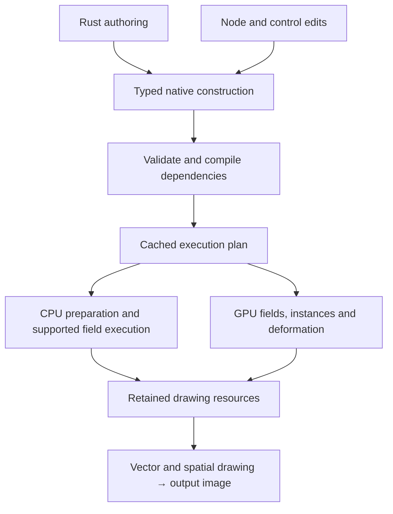

# Fold Unified Motion — proposal

> **RETIRED — 8 October 2026.** Historical design/implementation context only. The [Motion System Rewrite Plan](Motion_System_Rewrite_Plan.md) and its linked proposal supersede this document for motion and agent work. Examples and protocol descriptions below belong to the old system and are not rewrite contracts.

8 October 2026 · Proposed design, not implemented behavior or a delivery commitment.

## 1. Product

**One procedural Motion system for 2D, 2.5D, and 3D. Agents author complete animations in code. Artists edit the same construction through nodes, controls, and animation tracks.**

Geometry and attributes flow through explicit operations, as in Houdini. Scope stays focused on motion design: typography, vector artwork, repeated forms, image cards, animated meshes, and cameras.

- **2D:** curves, shaped text, fills, strokes, masks, and ordered transparent artwork.
- **2.5D:** planar artwork placed in space, with perspective, depth, camera movement, and optional lighting.
- **3D:** meshes, materials, lights, instancing, extrusion, and deformation.

All three use one model and editor. Bevy is the proposed spatial rendering backend, subject to a prototype. Fold owns procedural authoring and evaluation.

The compositor remains separate. Its image-processing nodes are outside this proposal.

## 2. The construction model

A **Geometry** connection carries an immutable collection of geometry parts and attributes. Nodes return new logical results; unchanged storage can remain shared.

| Term | Proposed meaning |
| --- | --- |
| Point | A position and attributes. It may be independent or participate in topology. |
| Curve | An ordered path with line or Bézier segments; it can be open or closed. Preserve control handles and subpaths. |
| Shape | Planar closed contours plus a fill rule. Holes remain explicit. |
| Mesh | Points connected into faces, with per-face and per-corner data. |
| Instance | A reference to shared geometry, with its own transform and attributes. |
| Attribute | A named, typed value on a declared domain. |
| Field | A typed expression sampled on a domain at an explicit time and coordinate space. |
| Scene | Geometry placements, cameras, lights, and presentation rules. |
| Asset | A reusable native construction with stable named inputs and outputs. |

Positions use XYZ; planar content starts at local `Z = 0`. UVs/layout can use Vector2. Rotation has its own type. Text retains glyph relationships until explicit conversion.

Domains are **collection, point, curve, face, face corner, and instance**. Text exposes glyph/cluster selections. Face corners permit UV and normal seams at shared points.

Standard attributes: `position`, `id`, `normal`, `uv`, `color`, `opacity`, `orientation`, `scale`, and `material`. Each declares a type/domain. IDs remain integers.

Nodes declare accepted geometry, domains, units, spaces, attribute transfer, and identity rules. Numeric attributes may interpolate; IDs/material references need discrete rules. Topology changes declare identity correspondence. Domain conversion and instance realization are explicit.

## 3. Shared operations, explicit spaces

Transform, copies, selection, attributes, timing, and falloffs work across compatible geometry. Stroke needs curves/shapes; Extrude needs planar profiles; Subdivide needs meshes.

Mixed collections are allowed. Unsupported selected parts produce diagnostics; unselected parts pass through.

Three placement modes define how flat and spatial content meet:

| Mode | Behavior |
| --- | --- |
| World | Geometry occupies scene space and can participate in camera projection, depth, and lighting. |
| Camera Plane | Planar geometry follows a named camera at an explicit distance, with a defined size rule. |
| Screen | Geometry uses logical canvas coordinates, explicit paint order, and no scene-depth test. |

Screen groups declare placement before/after the spatial pass. World geometry uses depth and an explicit transparency policy. Coplanar paint order must not rely on tiny Z offsets. Intersecting translucent surfaces need more than object sorting.

Screen artwork uses logical canvas units. World units and axes are explicit. Space conversions are explicit; orthographic cameras support flat presentation.

## 4. Vector appearance remains native

Fill and Stroke retain their meaning before rasterization. Curves are not permanently converted to triangles by ordinary appearance edits.

- **Fill:** solid color, gradient, or material, with nonzero/even-odd interior rules.
- **Stroke:** width, cap, join, miter limit, dash pattern, and alignment. Width declares local units, world units, or output pixels. Inner/outer alignment requires a suitable closed planar contour.
- **Unlit material:** preserve graphic color without a lighting response.
- **Surface material:** respond to lights through a bounded physically based material model.
- **Extrusion:** generate front, back, and side surfaces with named material regions. Caps must respect holes.

A contour stroke, mesh edge ribbon, and camera silhouette outline are different operations. Do not overload Stroke to imply all three.

Reuse proven vector coverage. Spatial tessellation uses a projected-error tolerance and cached detail levels. Color edits must not rebuild topology; camera scale can change required detail.

## 5. Agent language and native editing

**Rust builders and nodes describe the same typed construction.** Author-time functions build assets; symbolic fields retain animation and per-element behavior. Saved constructions evaluate without rerunning builder source.

For example, an agent should be able to declare this intent directly:

```text
Proposed semantic sketch — not executable SDK syntax

scene "launch": 1920×1080, 30 fps, 6 seconds
control "word": Text = "FOLD"
control "copies": Integer = 24
control "depth": Distance = 12 scene units

"title" = Text(word) → Align(center) → Fill(brand_color) → Stroke(white)
"solid" = Text Outlines(title) → Extrude(depth) → Assign Material(metal)
"ring"  = Distribute Points(mode=circle, count=copies, radius=300)
"forms" = Copy to Points(solid, ring)
"spin"  = Rotation(axis=Z, angle=Time × 30 degrees/second)
"forms" = Instance Transform(forms, rotation=spin)

place title in Screen space
place forms in World space
view through Camera("main")
output Scene("launch")
```

Copies and motion remain procedural. Conversions declare appearance transfer; extrusion does not automatically turn a screen-width stroke into a solid border.

Generate schemas, SDK declarations, metadata, and documentation from operation definitions: meaning, types/domains, defaults, limits, and tested examples. Agents query relevant subsets.

Stable keys identify components, drivers, and controls. Code owns generated internals; artists own exposed values, connections, animation, and placement. Revisions preserve compatible edits and report conflicts. Arbitrary source/graph reconciliation is deferred.

The normal public workflow is **discover → author candidate → inspect → observe → revise → commit**. It must support:

- Reference frames with exact timestamps; named scenes, ranges, and key moments.
- A semantic change summary, stable handles, and one undoable commit.
- Contact sheets, short previews, motion trails, and full-resolution crops.
- Attribute summaries, selections, bounds, material assignments, and camera visibility.
- Diagnostics linked to source keys/nodes, with expected type/domain and repair options.
- Snapshot-bound observations that do not move artist playback.
- Performance attribution: field work, topology changes, transfers, CPU fallbacks, and GPU cost.

Validation, rendering, and visual success are separate. Sampled checks state times and uncertainty. A reference does not reveal a unique source graph.

## 6. Execution and performance



The **authoring graph** preserves meaning. The **execution plan** combines operations, removes unused work, and retains diagnostic mappings.

Compile fields into typed intermediate operations. Fold constants, hoist uniform work, and fuse compatible CPU loops/GPU kernels. Avoid per-node allocations and dispatches. Sampling and ordering can prevent fusion.

Track **source/topology, static attributes, time-dependent attributes, and camera/output preparation** separately. Cache by dependencies, not coincidental frame equality.

Use packed attributes and shared geometry. Keep GPU results resident. CPU fallbacks report transfer costs. Small/irregular work can remain on CPU. Arbitrary Rust is not automatically GPU-compatible.

Initial motion is stateless: any requested time must evaluate without prior playback. Keep rational requests/key times. Specify GPU `f32` precision, integer ID encoding, seeded hashes, and CPU/GPU tolerances. Provide reference execution; do not require bit-identical transcendental results across devices.

Motion owns geometry and field semantics. Composition retains common layer timing and hierarchy. Project stores opaque feature documents; Render receives feature-neutral drawing data.

Fold owns scheduling, budgets, cancellation, and snapshots. Bevy receives evaluated data and returns a working-space image. Its runtime world is disposable. Prove shared GPU ownership/accounting and completion. Apply Fold's display conversion once.

Select optimizations by device capability. Use configurable memory budgets. Report exhaustion or offer explicit quality choices; never silently drop copies or alter geometry.

## 7. Proposed node catalog

Labels and keys are provisional. Share modes when contracts match; avoid separate 2D/3D versions of the same operation.

**Core:** initial product target, delivered in slices. **Next:** later expansion. All entries are proposals. The catalog contains **88 nodes: 78 Core and 10 Next**.

### Sources and text

| Node | Key | Scope | Function |
| --- | --- | --- | --- |
| Shape | `shape` | Core | Rectangle, ellipse, or regular polygon/star as planar contours. |
| Curve | `curve` | Core | Author open/closed line and Bézier paths with control handles. |
| Text | `text` | Core | Shape text with embedded fonts, paragraph controls, and glyph/cluster identity. |
| Text Select | `text_select` | Core | Select entries or grapheme clusters from text with explicit wrap/clamp behavior. |
| Format Text | `format_text` | Core | Convert typed values to text using bounded templates and numeric formats. |
| Text on Points | `text_on_points` | Core | Generate labels from fields at selected points; share repeated shaping results. |
| Mesh Primitive | `mesh_primitive` | Core | Create plane, box, sphere, cylinder, cone, or torus geometry. |
| Geometry Input | `geometry_input` | Core | Reference imported geometry through explicit asset and format capabilities. |
| Image Input | `image_input` | Core | Reference still/video/document images with explicit source-time mapping. |
| Image Plane | `image_plane` | Core | Place an image on planar geometry with fit and UV rules. |

### Geometry and layout

| Node | Key | Scope | Function |
| --- | --- | --- | --- |
| Transform | `transform` | Core | Transform selected geometry or instances in a declared space. |
| Set Position | `set_position` | Core | Replace or offset selected point positions with a vector field. |
| Align | `align` | Core | Align bounds to an anchor or target without destroying child relationships. |
| Fit | `fit` | Core | Fit geometry inside a box; choose contain, cover, or explicit stretch. |
| Measure | `measure` | Core | Return bounds, center, dimensions, count, or curve length with a declared measurement policy. |
| Layout | `layout` | Core | Arrange elements in rows, columns, or grids using measured bounds and gaps. |
| Merge | `merge` | Core | Combine geometry while retaining source identity and compatible attributes. |
| Filter | `filter` | Core | Keep or delete selected elements using explicit topology-repair rules. |
| Text Outlines | `text_outlines` | Core | Convert shaped glyphs to editable planar contours; retain glyph IDs as attributes. |
| Resample Curve | `resample_curve` | Core | Sample curves by count or distance with a declared error tolerance. |
| Trim Curve | `trim_curve` | Core | Select a curve interval by normalized length, including animated reveal. |
| Offset Curve | `offset_curve` | Next | Offset planar contours with explicit corner and self-intersection handling. |
| Tessellate | `tessellate` | Core | Convert selected planar shapes to meshes while respecting holes and fill rules. |
| Extrude | `extrude` | Core | Add depth to planar profiles; generate caps, walls, and material regions. |
| Sweep | `sweep` | Next | Carry a profile along a curve using a defined orientation frame. |
| Subdivide | `subdivide` | Next | Refine mesh topology and transfer attributes under a selected scheme. |
| Bevel | `bevel` | Next | Replace selected mesh edges with bounded bevel geometry. |
| Recalculate Normals | `recalculate_normals` | Core | Generate face/corner normals with explicit smooth-edge rules. |
| UV Map | `uv_map` | Core | Generate planar, box, cylindrical, or spherical texture coordinates. |

### Points and instances

| Node | Key | Scope | Function |
| --- | --- | --- | --- |
| Distribute Points | `distribute_points` | Core | Generate line, grid, circle, or volume-lattice points with stable identities. |
| Scatter Points | `scatter_points` | Core | Seed points inside planar shapes or on mesh surfaces; define density and distribution. |
| Points on Curve | `points_on_curve` | Core | Place points by arc length with tangent orientation and optional travel. |
| Copy to Points | `copy_to_points` | Core | Instance source geometry on points using orientation, scale, and source-selection attributes. |
| Instance Transform | `instance_transform` | Core | Set per-instance position, rotation, and scale with fields and selection. |
| Realize Instances | `realize_instances` | Core | Expand selected shared copies into explicit geometry within a declared budget. |
| Sample Geometry | `sample_geometry` | Next | Sample attributes from another geometry set by ID, nearest point, or surface location. |

### Fields, selection, and attributes

| Node | Key | Scope | Function |
| --- | --- | --- | --- |
| Value | `value` | Core | Supply a typed literal or parameter value. |
| Element Info | `element_info` | Core | Read index, stable ID, domain count, and supported geometric context. |
| Read Attribute | `read_attribute` | Core | Read a named typed attribute; declare missing-value behavior. |
| Store Attribute | `store_attribute` | Core | Evaluate a field on a domain and store its result. |
| Convert Domain | `convert_domain` | Core | Transfer or reduce attributes between domains with an explicit policy. |
| Math | `math` | Core | Typed arithmetic, rounding, min/max, powers, and supported trigonometric operations. |
| Vector Math | `vector_math` | Core | Compose/split vectors; dot, cross, length, normalize, and distance. |
| Rotation | `rotation` | Core | Construct and combine rotations; aim axes and interpolate orientation. |
| Compare | `compare` | Core | Produce selections from typed comparisons with explicit tolerance where relevant. |
| Logic | `logic` | Core | Combine Bool fields with AND, OR, NOT, and XOR. |
| Select | `select` | Core | Choose between compatible values or geometry branches. |
| Map Range | `map_range` | Core | Remap values with optional clamp and curve shaping. |
| Mix | `mix` | Core | Interpolate compatible values; rotations use rotation-aware interpolation. |
| Random | `random` | Core | Generate stable seeded values from IDs and a named random stream. |
| Noise | `noise` | Core | Evaluate bounded spatial/time noise with defined dimensions, seed, and output type. |
| Falloff | `falloff` | Core | Generate planar, radial, box, or curve-distance influence in a declared space. |
| Ramp | `ramp` | Core | Map a scalar through editable scalar or color stops. |
| Convert Space | `convert_space` | Core | Convert positions, directions, or normals using their correct transform rules. |
| Expression | `expression` | Core | Compose restricted typed field expressions that use the same CPU/GPU compiler. |

### Time and motion

| Node | Key | Scope | Function |
| --- | --- | --- | --- |
| Time | `time` | Core | Read an explicit scene/local clock and rational-rate frame information. |
| Timing | `timing` | Core | Map a range to progress with clamp, repeat, or ping-pong behavior. |
| Keyframes | `keyframes` | Core | Sample typed animation tracks with defined interpolation. |
| Ease | `ease` | Core | Shape progress using standard easing or an editable normalized curve. |
| Oscillator | `oscillator` | Core | Generate periodic fields with duration/BPM, amplitude, phase, and waveform. |
| Stagger | `stagger` | Core | Offset upstream sampling time by an explicit order or delay field. |
| Time Remap | `time_remap` | Core | Evaluate a declared upstream region at mapped time; expose caching and dependency costs. |
| Spring | `spring` | Next | Sample an analytical damped transition between declared endpoints; no persistent simulation state. |

### Appearance and image-driven geometry

| Node | Key | Scope | Function |
| --- | --- | --- | --- |
| Fill | `fill` | Core | Assign solid/gradient fill and interior rule to planar shapes. |
| Stroke | `stroke` | Core | Define curve/shape outlines, caps, joins, dashes, alignment, and width space. |
| Color | `color` | Core | Construct or convert color with explicit encoding and working-space policy. |
| Material | `material` | Core | Define unlit or physically based surface appearance with supported texture inputs. |
| Assign Material | `assign_material` | Core | Bind materials to selected geometry, faces, or instances. |
| Set Opacity | `set_opacity` | Core | Change selected appearance opacity with a declared combination rule. |
| Clip | `clip` | Core | Clip planar artwork with a shape in an explicit space; preserve editable inputs. |
| Sample Image | `sample_image` | Core | Produce GPU fields from image channels or luminance at UVs with declared sampling. |
| Image to Points | `image_to_points` | Core | Build a fixed lattice with image-driven attributes; explicit selection controls visibility. |
| Image to Glyphs | `image_to_glyphs` | Next | Select glyph instances from an atlas using sampled image values. |
| Edge Outline | `edge_outline` | Next | Generate selected mesh-edge or camera-silhouette outlines under an explicit mode. |

### Deformation

| Node | Key | Scope | Function |
| --- | --- | --- | --- |
| Displace | `displace` | Core | Offset positions along a direction or normal using a scalar/vector field. |
| Bend | `bend` | Core | Bend positions around a declared axis and range. |
| Twist | `twist` | Core | Rotate positions along an axis using distance and influence. |
| Taper | `taper` | Core | Scale cross-sections along an axis with a profile field. |
| Morph | `morph` | Next | Blend geometry with declared matching topology or correspondence; reject undefined matches. |

Deformation declares its representation: curve controls, tessellated points, or mesh points. Moving Bézier handles is not exact general curve deformation. Include normal/bound updates in its cost.

### Scene and reuse

| Node | Key | Scope | Function |
| --- | --- | --- | --- |
| Place | `place` | Core | Place geometry in World, Camera Plane, or Screen mode. |
| Camera | `camera` | Core | Define perspective/orthographic projection, clipping, framing, and transform. |
| Light | `light` | Core | Define directional, point, or spot illumination with explicit intensity units. |
| Environment | `environment` | Next | Define supported environment lighting separately from visible background. |
| Scene | `scene` | Core | Assemble placements, cameras, and lights; declare ordering and transparency policy. |
| Output | `output` | Core | Publish a named typed result; a scene image requires an explicit camera. |
| Input | `input` | Core | Expose a typed asset input with defaults, units, ranges, and descriptions. |
| Group | `group` | Core | Evaluate a reusable native construction with instance overrides. |
| Reference | `reference` | Core | Reference another native result through a stable ID and declared dependency. |

Publication, compilation, observation, and commit are authoring operations. Cameras/lights use typed connections distinct from Geometry.

## 8. Initial scope, proof, and migration

Deliver core capabilities in complete slices:

1. **Planar foundation:** typed geometry/attributes, fields, retained text/curves, Fill/Stroke, shared copies, timing, and agent discovery/observation.
2. **Spatial proof:** the same artwork plus meshes, extrusion, a camera, unlit/lit materials, and correct depth in one construction. Qualify Bevy integration here.
3. **Throughput:** GPU field fusion, retained attribute buffers, deformation, dependency-aware caching, and source-level performance diagnostics.
4. **Production authoring:** source revision, artist continuation, robust errors, save/reopen, export parity, and explicit migration tools.

Design GPU-compatible data in slice 1; slice 3 qualifies broader execution coverage.

Initial exclusions: custom solvers, physics, fluids, topology booleans, character rigging, arbitrary Rust-to-GPU compilation, and universal source/graph reconciliation. Existing Solver projects need explicit compatibility handling.

Freeze benchmark scenes and hardware. Target full-quality 1080p60 on the modest reference machine; test 4K and larger workloads on workstations. These are goals. Measure sustained presentation, P50/P95/P99, stalls, cold compilation, edit/seek latency, transfers, and memory.

Benchmark 1k/10k/100k instances, vector overlap, changing text, mesh deformation, and mixed scenes separately. Counts do not guarantee FPS. Test CPU/GPU agreement, seek order, cancellation, low-memory recovery, and concurrent preview/export.

Agent tests start from unfamiliar references and blank projects, using public tools. Require full animations, visual revision, controls, and artist-to-agent continuation across several held-out briefs.

Keep the current engine until replacements qualify. Migrate selected projects explicitly, preserving originals and reporting incompatibilities. Reuse sound algorithms. Retire duplicates after behavior/artwork acceptance; never migrate automatically on open.

## 9. Decisions to settle through prototypes

- Shared Fold/Bevy GPU resources, allocation accounting, and offscreen working-color output.
- Vector coverage versus spatial tessellation quality at extreme zoom and perspective.
- Transparent spatial intersections and integration with ordered screen artwork.
- Initial world axes/unit convention, numeric tolerances, and curve deformation policy.
- Supported imported geometry formats and attribute/material preservation.
- CPU/GPU partition thresholds and measured source-edit compilation latency.

## Basis

This proposal extends the discussion's agreed direction. It does not supersede shipped contracts until implementation and review.

- [Current Motion reference](Fold_Motion_Graphics_Reference.md): existing capabilities and limitations.
- [Agent-first research](research/fframes-agent-first-unified-motion.md): verified fframes lessons and proposed adaptation.
- [Rust assets](phase-56-live-rust-assets.md): retained authoring and artist ownership already established in Fold.
- [Motion performance](phase-46-motion-performance.md) and [shared vector rendering](phase-46A-shared-vector-rendering.md): measured costs and reusable work.
- [Product specification](Fold_Application_Product_Architecture.md), [architecture](architecture.md), and [development status](../dev-plan.md): existing package ownership and acceptance records.
