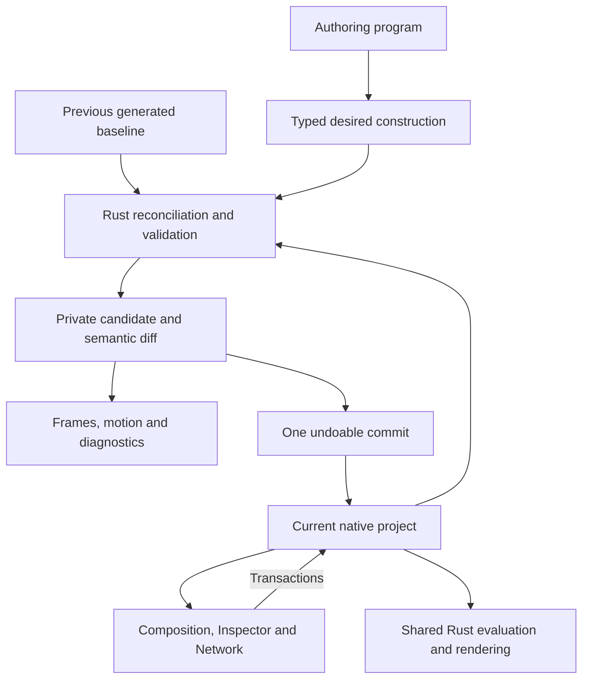

# Motion authoring overhaul: programs that produce editable constructions

> **RETIRED — 8 October 2026.** Historical design/implementation context only. The [Motion System Rewrite Plan](Motion_System_Rewrite_Plan.md) and its linked proposal supersede this document for motion and agent work. Examples and protocol descriptions below belong to the old system and are not rewrite contracts.

2026-10-07. Engineering recommendation following the fframes investigation. This is a proposed refinement of the incomplete Phase 47, not a shipped interface, completed milestone, or authorization to migrate existing artwork. Code examples below are interface sketches and are not executable Fold SDK examples.

The subsequent user-approved [Phase 56](phase-56-live-rust-assets.md) adopts Rust/Wasm as the first frontend and explicit code-owned internals/artist-owned controls. Its implementation contract supersedes the provisional JavaScript choice below; broader property reconciliation remains future work.

## Recommendation

Replace the current agent-facing Motion authoring model with a declarative composition compiler. Let an agent describe content, layout, timing, repetition, and relationships in ordinary code. Compile that description into Fold's native layers, graph, controls, and animation. Keep the saved native construction authoritative and reconcile subsequent source edits with artist edits.

Take heavy reference from fframes' composition vocabulary and review loop. Do not adopt its per-frame SVG program as Fold's primary project model. The reviewed fframes implementation makes source code authoritative; it does not provide the persistent editable graph and reconciliation that Fold needs. A wholesale fork would exchange an existing renderer and editing infrastructure for another renderer while leaving the central authoring problem to build. See the [primary-source research](fframes-authoring-research.md).

Be willing to replace Motion internals where they obstruct this model: property contributions, scope/domain handling, parameter definitions, and graph lowering. Keep the parts that already meet Fold's requirements: transactions, candidate snapshots, stable identities, common Composition ownership, native rendering, and independent feature packages. Existing infrastructure is useful; retaining the v2 SDK's semantics is not a goal.

## What is actually wrong today

These findings come from implementation and recorded outcomes, rather than a fresh controlled agent benchmark.

| Evidence | Consequence |
|---|---|
| [SDK v2](../skills/fold/sdk/authoring.mjs) exposes nodes, socket strings, graph roles, tagged input bindings, and raw edits. Its declaration file still uses `Record<string, unknown>` for general operations/settings. | JavaScript shortens serialization, but agents still need substantial knowledge of graph implementation. |
| Constructors initialize only; explicit setters update. A local probe replaying `text('title', 'Revised title', {size:96})` against existing bindings emitted zero edits, only `remember`. This agrees with the SDK tests and [documented contract](../skills/fold/references/live-tools.md). | Editing a composition's apparent source can do nothing. This intentionally protects artist edits but breaks the expected code-edit-preview loop. |
| [Native expressions](../crates/motion/src/fields/expression.rs) support a small typed AST. The SDK exposes nested `expr.binary`/`expr.unary` construction; graph linkage remains explicit. | Familiar arithmetic, timing and relational layout are expensive to express. The existence of an expression node is not an effective motion language. |
| [Input animation](../crates/motion/src/animation/parameters.rs) requires literal inputs and rejects a connected driver. The architecture proposes richer [property contributions](Fold_Application_Product_Architecture.md#property-stacks-explain-the-result). | A keyframed base plus additive wave/noise is not one uniform property contract. Syntax cannot resolve that ambiguity by itself. |
| [Phase 51](phase-51.md) gives artists a common Composition/layer model. Public high-level authoring of that model remains a follow-up; existing SDK generators build provider documents. | Agents and artists do not yet start from the same composition model. Building another excellent provider-graph demo would leave this disconnect intact. |
| [Command trial](evidence/phase-47/baseline-command-01/review.md): 118 reported calls and visually failed/static output. [SDK trial](evidence/phase-47/sdk-01/review.md): 57 reported calls, seven failed jobs, three direct errors, and inadequate reference motion/fidelity. | Transport reliability and structural validity do not establish creative success. These developmental runs had confounds and cannot quantify the effect of a particular interface choice. |
| [Phase 48](phase-48.md) successfully reproduces Badge and preserves artist changes, but Phase 47's broader acceptance remains incomplete. | The solution must generalize beyond a few named recipe helpers. Adding more bespoke tools is insufficient. |

Do not restart Phase 47 as another list of familiar promises. Its new discriminating requirement should be: **editing the program produces a meaningful native change, and alternating program/artist edits remains predictable.**

## What to take from fframes

fframes uses Rust, SVG composition, and explicit animation sampling. It is not evidence that TypeScript or JSX is required. The reusable pattern is ordinary programming constructs around a coherent visual vocabulary, with a strong loop for observing the result. Its source exposes scene/frame addressing, contact sheets, onion skins, inspection and snapshots. Source review establishes these mechanisms; it does not independently verify advertised productivity or performance.

Borrow:

- Familiar text, paths, shapes, transforms, fills, strokes, clipping and grouping, composed with functions and collections.
- Named scenes and local clocks; compact ranges, easing, transitions, and reusable motion phrases.
- Shared design parameters, reusable components, layout measurements, and rich examples that teach composition and timing.
- A review loop that makes errors and motion legible: useful frame selection, motion trails, full-resolution detail, runtime diagnostics and comparisons.

Adapt deliberately:

- SVG-like content descriptions must become retained Fold geometry and references. SVG strings or rendered frames are not sufficient native editability.
- Animation descriptions must retain curves and signal dependencies, rather than only the sampled values of one frame.
- Rust functions in fframes may construct different trees at different times. Fold should represent common dynamic cases as explicit switches, repeats and simulations with stable identities and declared limits.
- Code reuse alone does not create an artist-editable reusable asset. A Fold definition needs stable parameters, instance identity and clear local-versus-shared edits.

## The central seam



The deep module is the **construction compiler and reconciler**. Its interface accepts a versioned desired construction, a pinned native snapshot, the last generated baseline, and explicit conflict resolutions. It returns a native edit proposal, source-to-object mappings, a readable semantic diff, and diagnostics. It owns the hard work currently distributed across agent scripts: identities, roles, wiring, scope checks, preservation and update semantics.

The desired construction is a transient compiler representation. Do not introduce a second persisted scene that the renderer and inspector have to synchronize. Persist the native project plus bounded authoring provenance/baseline metadata. Rendering must work after reopening without executing the authoring program.

Composition continues to own hierarchy, shared transforms/opacity, ranges and clocks. Motion owns procedural content, fields, geometry and Motion-specific controls. Compositor owns image processing, Timeline owns editorial assembly. Each package lowers and reconciles its own meaning; the application coordinates their edit proposals. Keep feature-specific desired models out of project/render infrastructure.

## Language contract

Start with typed JavaScript authoring over the existing bounded runtime, with TypeScript declarations for editor/agent assistance. TypeScript source syntax would require an explicit transpilation/type-checking path; QuickJS currently accepts JavaScript, not TypeScript. Runtime Rust validation remains authoritative.

This is a provisional frontend choice for rapid iteration, not a claim that agents cannot write Rust. A Rust builder that returns the same construction description is credible, particularly for operator-overloaded symbolic expressions and SVG-like macros. Compare the languages on identical tasks before expanding the frontend implementation. Do not build two production runtimes in parallel or promise compatibility with arbitrary fframes programs.

Separate three things:

1. **Author-time code:** normal functions, loops, arrays, reusable helpers and calculations run once to describe a construction. No implicit access to the current playhead.
2. **Retained animation and fields:** typed signals, keys, layout dependencies and explicit element scopes persist in the native graph and evaluate in Rust at exact time.
3. **Custom execution:** existing Rust/Wasm Wrangles remain an explicit escape hatch. They have named controls, declared domains/dependencies, bounded execution and honest limits on internal visual editability.

Do not pretend ordinary JavaScript arithmetic creates symbolic dependencies. Signal arithmetic needs explicit builders such as `.add()`/`.mul()`; branching needs an explicit selection operation. Reject accidental coercion. A later expression parser or macro frontend can improve syntax, but must compile into the same typed fields and reject unsupported constructs. Do not run arbitrary authoring callbacks once per frame to conceal missing semantics.

### Example of the intended experience

Proposed JavaScript-shaped syntax, **not an implemented SDK**:

```js
const comp = composition('launch', {
  size: [1080, 1080], rate: [30, 1], duration: frames(120)
});
const title = comp.text('title', {
  text: 'FOLD', font: assets.font('brand'), size: 180,
  fill: color.srgb('#f5c451'), align: 'center'
});
title.layout.centerIn(comp);

const rise = comp.control('rise', {
  label: 'Rise', value: 64, unit: 'px', range: [0, 200]
});
title.motion('entrance', {
  scope: 'object',
  offset: keys([
    [frames(0), vec2(0, rise)],
    [frames(18), vec2(0, 0)]
  ], {ease: 'cubicOut'})
});

const dots = comp.repeat('dots', {
  source: circle({radius: 7, fill: color.srgb('#f5c451')}),
  distribution: grid({columns: 20, rows: 5, spacing: [28, 28]})
});
dots.layout.below(title, {gap: 36, bounds: 'ink'});
dots.motion('wave', {
  scope: 'instance',
  offset: vec2(0, wave({period: frames(60), amplitude: 16,
                       phase: instance.index.mul(0.12)}))
});

return comp;
```

This sketch specifies persistent relationships, not just convenient setters. Replacing `FOLD` with a longer title updates dependent layout. Changing amplitude edits one driver. Changing grid count edits a retained distribution, without creating one graph node per dot. `rise` is an exposed native control; the keys and wave retain named, inspectable drivers. Parameterized key values require native control dependencies, not sampled numbers baked by the authoring host.

The sketch intentionally exercises missing semantics. Each feature must be supported end-to-end or rejected as unavailable; silently baking values to imitate support would defeat the proposal.

### Required creative vocabulary

| Area | Necessary meaning |
|---|---|
| Text/layout | Explicit font asset/fallback, shaping, ink versus layout bounds, alignment, fit and persistent measured relationships. Whole phrase, glyph and shaped-cluster scopes must be distinct. |
| Drawing/style | Paths, fills, strokes, gradients, masks and explicit geometry-versus-image effects. Contour conversion/offset/trim remain capability work where absent; no wrapper can invent them. |
| Motion | Exact-time keys and ranges, easing, loop/ping-pong, phase, stagger, spring/noise, and named local clocks. Distinguish analytical spring motion from stateful simulation. |
| Distribution | Grid, line, radial/path placement, instances and seeded variation. Current order and stable identity are different inputs. |
| Contributions | Authored base, ordered drivers, combine mode and influence. A drag edits the base; a selected driver has its own keys/parameters. |
| Reuse | Explicit reusable definitions and instances with controls/units. Ordinary helper functions may simply expand independent content; sharing must be intentional. |

Units, coordinate spaces, color encoding and local-time mapping belong in this contract. Hex colors explicitly identify sRGB and convert using the project's color policy. Frame offsets resolve using the named composition's rational rate. Duration endpoints remain half-open. Layout dependencies participate in cycle detection and font/resource invalidation.

## Code and artist edits: explicit reconciliation

Do not promise to reconstruct arbitrary original loops, variable names or helper functions from an artist-edited graph. Native inspection can return a normalized editable description plus source mappings. Source text records author intent/history; the effective native construction records current artwork.

For each declared native property, compare **B** (last generated value), **L** (current live value) and **N** (new generated value):

| Condition | Action |
|---|---|
| N equals B | Preserve L, including artist edits. |
| L equals B | Apply N. |
| L equals N | Already resolved; retain that value. |
| Both changed differently | Return a specific conflict with values, target and supported resolutions. |

Example: generated amplitude is 40; the artist changes it to 65. An agent changes title text only, so 65 survives. If the agent changes amplitude to 80 as well, it gets a targeted conflict and can deliberately choose 80 after observing the artist's value. Retaining 65 or taking 80 is explicit, not a hidden policy. After a successful proposal, persist N as the new generated baseline with the native result in the same transaction; undo/reopen must restore both.

Property stacks improve the common case: artist base position and generated motion offset are distinct properties, so both can change without a false conflict. A new connected driver versus a literal/keyframed input is a structural change, not a numeric merge.

Structural rules:

- Stable keys identify declared components and named motion contributions; display-name changes do not change identity. Reparenting does not implicitly change a key. Repeated elements use explicit key/domain policies.
- Reconcile only a declared authoring region. Full-region replacement may propose removal of omitted previously generated members; a targeted patch never treats omission as deletion.
- Removing a generated member with artist changes, unknown attachments or references from outside the region produces a conflict. Unmentioned artist-created and disconnected work survives.
- Artist deletion leaves a tombstone. Unchanged source does not resurrect it; subsequent source changes require explicit recreation or adoption of a replacement.
- Editing inside a generated group is allowed. If the compiler cannot reconcile the new topology, preserve it and report that exact structural conflict. Never rebuild the group silently.
- Existing manually authored artwork requires explicit adoption of selected targets and a captured baseline. No implicit ownership based on names and no automatic migration on open.
- Definition edits versus instance edits are explicit. An affected-instance summary accompanies shared-definition changes.

The first implementation should reject unresolved conflicts for the whole proposal. Keep the existing global revision/generation guard; per-property reconciliation does not by itself make rebasing a concurrent live edit safe. Candidate baselines advance only after successful candidate staging and commit atomically with artwork.

## What the artist should see

Apply the [Fold UI guidance](../.agents/skills/fold-ui/SKILL.md): Composition is the entry point, Inspector exposes meaningful controls, and Network reveals the same construction. No additional mandatory programming panel.

For the example, show Title and Dots in Composition. Title's properties expose text, font, size and Rise; its Entrance timing is accessible in Composition. Dots exposes the source circle, grid, gap and Wave. Network shows semantic nodes/groups with those names and navigable source/driver relationships. Primitive internals expand when useful.

Do not emit a wall of arithmetic nodes for every expression or materialize each copy into a separate layer. Retain compact typed expressions inside named native drivers and instance distributions. A control must actually drive the retained construction, not merely label an opaque script.

In a source-aware inspection, report original declared value, effective value, artist modification and mapped native target. A changed source region must produce an understandable native diff before Apply. This design preserves unrestricted graph refinement without pretending every graph operation has an exact original-source rewrite.

## MCP should carry the authoring loop

Keep MCP and CLI thin. Reuse the existing candidate, author, inspect, observe, jobs and commit machinery where its semantics fit. Tool-count reduction alone is not the objective.

The normal loop should be: inspect a compact composition summary → submit a program → receive a staged semantic diff and diagnostic summary → observe representative motion → revise → commit once. Offer a bounded author-and-observe convenience request with one pinned resulting generation; return a job when necessary. Avoid making the agent manually orchestrate each transport detail of this common loop.

Improve observation alongside creation:

- Accept scene/local-range addressing and choose samples at declared key events, immediately around transitions, and between them; exact sample times remain in receipts.
- Provide contact sheets, short motion previews, motion trails/onion skins, and full-resolution crops without moving artist playback.
- Explain known failures using actual evaluation evidence: missing font, empty selection, off-canvas bounds, invalid domain, invisible/masked output where measurable. Report unknown causes honestly.
- Return source key/native target/source location where available, expected type/scope/space, and a repair path. Generated source locations need an explicit mapping implementation, not guessed line numbers.
- Separate compile/validation, evaluated semantics, render success and visual review. Record observation generation, color/quality, dependencies and backend identity.

Generate supported property definitions, SDK declarations, inspector metadata and executable references from package-owned definitions. Generate within the chosen first slice, then expand coverage. Requiring every old operation to be redesigned before any end-to-end creative trial would delay the important evidence.

## Alternatives and replacement scope

| Option | What it buys | What it leaves unresolved | Recommendation |
|---|---|---|---|
| Fork fframes as the main engine | Rust/SVG authoring, render/export and review workflow | Native persistent graph, artist controls, reconciliation, Fold's composition/color/time/package integration | Do not choose on current evidence. |
| Embed fframes as an opaque source layer | Code-driven frame output | Artist can edit only deliberately exposed parameters; internals remain source-owned | Possible separate future interoperability feature, not the answer to this request. |
| Add more helpers to FoldPlan | Fast improvements to specific recipes | Create-only replay, graph-shaped interface, shared property semantics | Maintain compatibility; stop treating this as the overhaul. |
| Native construction compiler and reconciler | Familiar compositional code plus native editable artwork | Requires real semantic/compiler work and language trials | Recommended. |

Keep evaluation/rendering unless a matched benchmark demonstrates a specific deficiency. Reuse of individual fframes ideas or code should be assessed at a small seam with its dependency/license requirements; MIT at the repository root is not a performance result or a dependency audit.

## First implementation slice and decision gates

Build one complete typography-and-pattern slice before broadening recipes:

1. Pin a blank project and an artist-edited fixture under the current common Composition model. Record current public-tool outcomes and budgets on those exact builds.
2. Implement package-owned desired descriptions and native lowering for text, circle/path content, groups, grid instances, explicit controls, keyframed entrance and one phase/stagger driver. Include persistent centering/spacing with real text measurements.
3. Implement stable source mappings and B/L/N reconciliation for that subset, including artist rename, base placement, text, driver edits, deletion and structural conflicts. Use existing private candidates and undo.
4. Expose declarative JavaScript authoring through public MCP/CLI, with generated types, diagnostic paths and the current Composition/layer output. Exercise a compact Rust builder alternative against the same descriptions before settling frontend syntax.
5. Produce a kinetic type composition and a distinct data-driven repeated pattern. Render throughout the motion, revise the source, let an artist adjust controls/keys/graph wiring, then make a further agent revision. Save/reopen and confirm rendering without author-source execution.

Do not complete the slice on unit tests or attractive first renders alone. Require no-op source replay, intended source change, preservation of unrelated edits, explicit same-property conflict, count propagation, font/layout change, one-step undo/redo, persistence of baselines/tombstones, and preview/export agreement. Test limits and cancel/failure without partially publishing metadata or artwork.

Then compare public-only agents on the same briefs, capability coverage and fixed budgets. Track first-attempt and eventual completion, visual fidelity, unintended changes, control usability, repair count, calls/tokens, and time from source edit to useful observation. Independently review aesthetic outcomes; a nonempty render is not a pass. Include held-out briefs beyond the demonstrated helpers.

This adds concrete requirements to Phase 47, not a replacement for its existing five clean Luna/high reference trials and repeated task-suite gates. Those trials remain unperformed here. No new speed or success-rate claim is established by this investigation.

After equivalent coverage passes, retire the superseded public authoring surface and duplicate helper paths deliberately. Follow Phase 51's accepted policy: no automatic legacy-project conversion on open; explicit artifact migrations only within agreed scope. Do not remove functioning operations before their replacements pass creation, revision and native-handoff checks.

## Verification in this investigation

Read Fold's current authoring/runtime, identity storage, Motion expression and animation contracts, common Composition ownership, architecture and developmental trial evidence. Ran a side-effect-free Node probe confirming that changing existing `text()` constructor arguments produces no edit. Reviewed fframes primary sources through the companion research note. No engine changes, live artwork edits, renderer benchmarks, new agent acceptance trials or native UI validation were performed.
