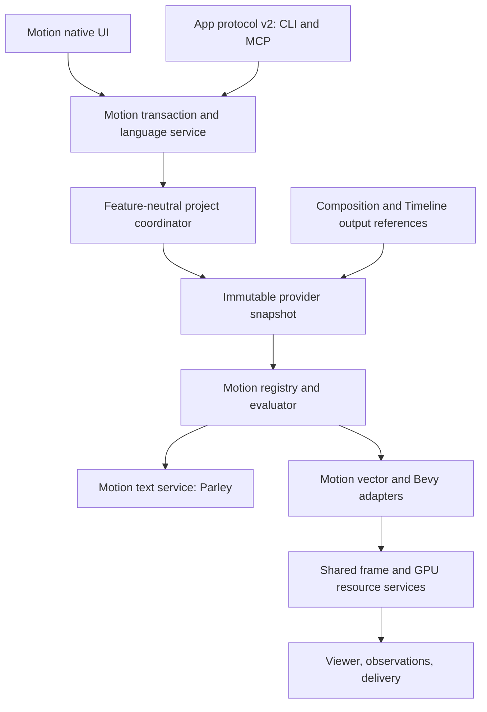

# M0 contract freeze

Status: design contract for new implementation, not implemented capability. Changes
must update this record and its acceptance fixtures before dependent work qualifies.
The rewrite plan owns sequencing. Baseline: `66ebb2ece465189a2f8dd3e415b38f63a62bdd6a`.

## Ownership

Motion owns document, language, registry, evaluation, text layout and lowering in
focused modules of `fold-motion`. Project owns opaque document payloads, revisions,
transactions and persistence. Platform owns provider discovery and asynchronous
jobs. Render owns image/color/resource contracts, never Motion nodes. App joins
providers and transports; it must not inspect Motion construction internals.
Timeline owns clips and provider-neutral output timing; Motion owns its key tracks.
Composition owns layers and output references. Compositor consumes image outputs.
No new crate is justified merely by a conceptual service name.

Retain project `Document.payload` as bytes and flattened unknown metadata (already
present in `crates/project/src/model.rs`). Retain coordinator, persistence and
candidate snapshots only after focused behavioral checks. Timeline and compositor
independently consume platform/render/media/color. Audit render vector and GPU
modules by consumer before retaining them: lack of a `fold_motion` import is not
proof of independence. Shared animation interpolation may be retained; old Motion
track ownership may not.

## Native identity and types

New package identity: `fold.motion.native`; document type: `fold.motion.construction`;
schema version: `1`. Old `fold.motion` payloads must never be decoded as this type.
Operation keys are `fold.motion.<catalog-key>`, operation version `1`; mode is a
separate stable string. A known operation with an unknown version is unresolved.
Unresolved records and extension fields round-trip without execution.

Document, node, parameter, edge, track, ramp, stop and asset-instance IDs are UUIDs. Names and
presentation layout never serve as identity. Generated element IDs are unsigned
64-bit hashes of operation UUID, upstream element identity and semantic slot;
collisions are detected within an output. External resource identities remain
separate. Random uses element ID, document seed and named stream, with its algorithm
version serialized. IDs never travel through floating-point attributes.

The M2 CPU evaluator qualifies rectangle geometry and screen placement. Its element
ID v1 is FNV-1a 64 over owning operation UUID bytes, instance-path length (u64 LE),
each instance UUID in path order, upstream element ID (u64 LE), then the semantic
slot bytes. Geometry/contour/point/placement slots are UTF-8; scene-occurrence slots
are the authored connection UUID bytes. UUIDs use network byte order. Slots distinguish geometry, contours,
points, placement and scene occurrences. Complete source keys are compared within
a request to report hash collisions. A rectangle has four separately identified
points in a closed contour, starting at its top-left origin and proceeding
clockwise in Screen coordinates. Dimensions must be positive. Geometry explicitly
carries Screen/Canvas; screen placement rejects other spaces or units. Opacity
outside [0,1] is an error. Scene list order is explicit.

Prepared constructions own validated document snapshots. Each evaluation request
has fresh instance-path caches, work and generated-element limits, a dependency
depth limit and cancellation. Instance overrides evaluate in their parent's scope
and clock before applying the child's local clock. Root override expressions use
scene time as their parent time. Scene Time always observes the request time.
Uniform expressions do not have an implicit element context. Shared geometry and
placements use owned immutable references; no rasterization is implied by CPU
reference qualification.

Values: Bool, Integer, Scalar, Text, Vector2/3, Color, Rotation, Duration, Distance,
AssetRef, Geometry, Points, Placement, Camera, Light and Scene. Units and spaces participate
in type checking. Color carries encoding and alpha semantics. Rotations use unit
quaternions, shortest-arc interpolation, and explicit Euler construction order.
Signal and Field wrap the same typed expression IR; field bindings specify domain,
space, upstream geometry snapshot and time. No implicit domain/space conversion.
Geometry parts retain contours/fill rules, paths, shaped text, meshes, points or
shared instances. Domains: collection, point, curve, face, face-corner, instance;
logical text selectors: grapheme, word, line, plus shaped glyph associations.

`Points` is an immutable distribution stream, not painted Geometry or a primitive
signal value. The initial `distribute.grid` mode carries explicit World/Meters,
row-major point order, integer `[column,row]` cells and f64 positions. The grid is
centered on its authored center; X/Y spacing is strictly positive. Columns/rows
are integers in [0,100000], total points cannot exceed 100000, and evaluated
positions must stay within ±1e6 meters. A zero count on either axis is an empty
stream with no bounds. The stream identity uses the owning operation and `grid`
slot; each cell uses that stream as upstream identity and the two u32 LE cell
coordinates as its eight slot bytes. These binary cell slots extend the M2 UTF-8
slot convention above. Growth/shrinkage and spacing/center changes preserve
surviving cell IDs; recentering changes positions explicitly. Flattened index,
count, position and sample time do not seed identity. The native evaluator's
existing element/work/cancellation limits apply before publishing a stream.

The initial `cloner.points` mode consumes one World/Meters mesh or text-solid
prototype and a World/Meters Points stream. It retains both immutable upstream
objects once; each instance carries its source-point ID and position. Instance
identity uses the Cloner operation/asset path, source-point ID and `instance` slot,
independent of point order, position and prototype dimensions. The collection ID
uses the stream ID and `instances` slot. Prototype appearance is inherited;
a downstream Material can replace collection appearance without copying meshes.
Planar and nested-instance prototypes reject in this qualified mode. Uniform instance scale is qualified by the separate scale Animator below;
instance rotation/color drivers remain unqualified.

Spatial conversion shares prototype buffers across all occurrences. Its private
renderer instance IDs use the first 128 SHA-256 bits of the v1 domain prefix and
placement/clone/part u64 LE identities; scene validation rejects duplicate IDs.
Conversion checks expanded instance count against the shared 4096-instance limit
before publishing, including multi-part text prototypes. Empty distributions
publish no renderer instances or mesh resources. Observation reports collection
bounds and instance/source-point associations separately from deduplicated
prototype topology; its unique_points count counts retained mesh vertices.

`animator.scale_multiply` samples a scalar factor separately for every incoming
Cloner instance. The bound context is the upstream instance ID, index, count and
World/Meters position, before this operation changes anything. Its output retains
instance IDs, positions, prototype and distribution references, multiplying the
existing uniform scale. The final scale must be finite and in [1e-6,1e6]. Chained
scale Animators therefore multiply explicitly, while position sampling stays tied
to each incoming snapshot. World placement applies its own transform afterward.

`animator.rotation_z_add` samples Angle (rad) per incoming instance, adds it to
the existing local Z rotation and normalizes to [0,2π). Each input angle must be
finite and within ±1e6 radians. Rotation acts around the prototype origin before
instance translation and World placement, retaining scale, color, IDs and shared
prototype data. Same-axis contributions compose additively. Observations expose
`rotation_z` in radians and apply rotation when measuring bounds. Spatial conversion
rotates glyph offsets and composes the local Z quaternion with World rotation.
Its current TRS representation requires equal World X/Y scale for rotated copies;
otherwise conversion explicitly rejects unsupported affine shear. General affine
instance composition remains an open rendering requirement.

`animator.color_replace` uses the same incoming instance context to sample a
straight linear Rec.709 color. It replaces the instance color, preserving scale,
positions, identities and shared prototype/distribution references. RGB must be
in [0,65504] and alpha in [0,1], matching spatial Material validation. A later
Color Animator replaces the earlier value, including alpha. The instance color
takes precedence over the collection Material's base color; an explicit Material
is still required for rendering and supplies unlit/roughness/reflectance settings.
Placement opacity multiplies the selected color's alpha at render preparation.
Colored copies receive stable per-copy material IDs, sharing the same prototype
mesh. The current adapter conversion admits at most 1024 materials; packed
per-instance material storage and aggregate GPU memory admission remain open.

`field.radial` returns Scalar Field / Instance / World with per-element cost.
Influence is clamp(1-length(position-center)/radius,0,1); radius is in [1e-6,1e6]
meters and center coordinates are within ±1e6 meters. The implementation executes
this formula through the existing expression IR and budget. Sampling without an
instance context fails; there is no invented position or implicit space mapping.
Center and radius accept existing signals. Per-instance samples isolate value and
child-scope caches, while budgets, cancellation and collision checks stay shared.
Text Animator uses this same cache-isolation mechanism for its delayed clock.
Scene Time remains global and asset inputs captured before sampling remain uniform.
The versioned Random expression uses the bound instance ID and owning
operation/named stream. Native `random.uniform` exposes Minimum, Maximum and Stream
controls and reuses that v1 expression/hash. The construction seed, Random node UUID,
stable instance ID and stream determine the unit sample; time, count, position and
traversal order do not enter the hash. Bounds map it as minimum +
(maximum-minimum)*sample. Bounds must be finite scalars within ±1e6, ordered with
minimum ≤ maximum; equal bounds produce a constant. Stream is 1..256 UTF-8 bytes.
The output is Scalar Field / Instance / World and requires an instance context.
Changing bounds can animate the range without reseeding the unit sample. This
supplies scalar variation to Animator controls, including Angle (rad) for native
Z rotation. A 0..2π range and stream `rotation` produces the frozen scene's static
per-cell rotation.

`field.linear` returns the same Scalar Field / Instance / World contract, with
Start and End controls in World meters. Influence is
clamp(dot(position-start,end-start)/dot(end-start,end-start),0,1). The endpoints
must be at least 1e-6 meters apart and each coordinate within ±1e6 meters.
Perpendicular displacement does not change influence; swapping endpoints reverses
its direction. Both endpoints accept signals. Position comes from the shared typed
element context, and projection is a bounded three-component native operation
under the same instance sampler, clock, caches, cancellation and work budget.
There is no invented position when evaluated outside an instance context.

`ramp.scalar_linear` and `ramp.color_linear` consume a scalar input plus a native
`ramp(<native-ramp-json>)` binding. Ramp and stop UUIDs are distinct persistent
identities. A Ramp retains its value type, 1..256 stops and opaque extensions;
stops retain IDs, dimensionless positions, values and opaque extensions. Positions
are finite, strictly increasing and within [0,1]. Input outside the stop range
clamps to its nearest endpoint. Scalar values interpolate linearly. Color values
interpolate component-wise in straight linear Rec.709, including alpha; there is
no implicit premultiplication, display conversion or HDR clamp. Other color
encodings and value families are rejected by these modes.

Stop insertion samples the existing response and creates one new ID. Repositioning
sorts by position while preserving stop IDs. Native validation/reconciliation
includes ramp/stop identity, including cross-object duplicate checks; extensions
remain opaque. Three-way merge combines different-stop edits and conflicts on
concurrent edits to the same stop or ramp contract. Stop lists sort numerically
after merge. Protecting the Stops parameter protects its complete ramp payload.
Native inspector stop controls use the existing edit lifecycle; the ramp is
neither a time track nor an external expression-only replacement.

Time is a reduced signed rational number of seconds with positive denominator;
checked arithmetic reports overflow. Evaluation supports negative times. Tween
clamps to endpoints outside its interval; keyframes default to hold extrapolation.
Duplicate key times are invalid. Asset time is `(parent - offset) * rate`, all
rational; rate zero freezes and negative rate reverses. Channels explicitly replace,
add or multiply; unsupported combinations fail validation. Stagger offsets channel
time; it does not remap arbitrary upstream work. Evaluation is acyclic and stateless.

M2 channel execution uses an explicit typed literal base for add/multiply. Replace
must have no base. Add supports Scalar, Distance and Vector tracks with a base of
the same type; multiply initially supports Scalar tracks only. Rotation and Color
tracks initially support replacement only. These limits are validation errors,
not implicit component or quaternion conversions. Linear/Hold describes the
segment beginning at each key; samples exactly at a key use that key's value.

Expression random v1 hashes seed (little-endian u64), owning operation UUID bytes
(network byte order), a one-byte element-presence tag, element ID (little-endian
u64; zero for uniform context), then UTF-8 stream bytes with FNV-1a 64. It applies
the SplitMix64 finalizer (xor-shift 30 / multiply `bf58476d1ce4e5b9`, xor-shift 27 /
multiply `94d049bb133111eb`, xor-shift 31), takes the upper 53 bits and divides by
2^53. Element IDs are never converted to floating point. Time and traversal order
are absent from this hash. This specifies CPU execution; GPU agreement is not yet
qualified. Expressions use a shared step budget and cancellation callback; invalid
arithmetic, non-finite results, missing element context and exhausted budgets
return errors.

Screen is top-left/Y-down logical canvas units with explicit order; World is
right-handed/Y-up meters. Camera Plane names its camera, distance and sizing rule.
No implicit Screen/World conversion. These conventions require M4 adapter tests.

A published output is a provider-neutral document/output reference plus declared
capabilities, time range, canvas and frame format. Providers accept immutable
snapshot and exact local time and return owned frame handles with color/alpha and
completion metadata. Infrastructure must not import Motion geometry types.

## Language and edit semantics

Declarative syntax supports typed inputs, literals, bounded expressions, named
operation calls, asset definitions/instances, outputs and explicit UUID metadata.
No loops, recursion, host imports, filesystem, network or arbitrary executable code.
Each native connection has its own UUID, a target reference and retained extension
metadata. Reference targets use input/node/instance-output UUIDs; an edge's identity
is not its target or list index. Scene reorder preserves occurrence identity through
these edge UUIDs. Duplicate edge IDs are rejected across the native object namespace.

The implemented expression and construction language is specified in
[expression-language.md](expression-language.md). It parses and prints native
constructions and the common IR, preserving source spans and identity annotations.
Full source round trips, scoped source transactions, asset-fragment reconciliation
and explicit identity mapping have automated M2 qualification. Public-tool and
native artist qualification remain M3 work. See [editing.md](editing.md) for the implemented protection boundary. Motion enables serde_json's
`float_roundtrip` parser so literal serialization does not change an f64 component.

Canonical printing retains identities and emits defaults consistently. ID-free
fragments create fresh identities unless the request supplies an explicit mapping.
Source spans map to native IDs, never the reverse authority. Presentation metadata
is stored independently of semantic source. Invalid edits preserve the source
buffer/diagnostics and leave the last valid document revision unchanged.

All editing surfaces produce the same validated transaction. Protected controls
are enforced on the final semantic diff, including ancestor/subgraph replacement,
asset override and source regeneration. Undo/redo restores semantic and presentation
state together. Revision numbers stay monotonic even when content is restored.

## Replacement public protocol

Wire contract version `2` is mandatory; reject all other versions before dispatch.
MCP transport negotiation is distinct from Fold's contract version. Discovery must
return implemented capabilities, operation schemas, limits and unavailable reasons.
Capability names remain Discover, Inspect, Propose, Observe, Apply and Cancel until
endpoints are implemented; this document does not advertise invented endpoints.
CLI and MCP share a single dispatcher and schema source. There is no v1 alias route.

Every session has a fresh epoch. Every write includes epoch, request UUID, base
revision, explicit scope and expected values for touched properties. Proposals
contain either scoped source or structured patches, validated through one service.
A candidate is an immutable generation bound to its base snapshot; amendments
produce new generations. Semantic diff includes additions, removals, value changes,
connection changes and protected-control changes. Disjoint property edits can rebase
only after expected-value and dependency validation; same-property edits conflict.
Deleting a parent conflicts with changes to any descendant. Apply requires the
exact inspected generation and commits one named undo group atomically.

Observe never changes artist playback or selection. Every result names epoch,
revision, candidate/generation if applicable, rational time, camera, output size,
quality, seed and asset/font/configuration fingerprints. M3 advertises CPU inspection
only; frames are unavailable until M4 qualifies them. Cancellation is cooperative;
already committed work returns `already_committed`, never a fictitious cancellation.

Local sockets are same-user only (0700 directory, 0600 socket, peer ownership check).
No remote listener. Project access and file writes are restricted to explicitly
opened project/resource roots; file save/export requires a declared destination.
The language cannot grant permissions. Reusing a request UUID with identical bytes
returns the same outcome; different bytes return `idempotency_conflict`. Retry
records live for the session within bounded capacity; eviction returns an explicit
expired request result rather than reapplying an uncertain write.

Initial limits: 1 MiB request, 16 MiB response, 64 KiB source, 128 patches/proposal,
10,000 operations/document, 1,000,000 evaluated elements, 64 asset nesting levels,
4 live candidates/session, 15 minute idle candidate expiry, 64 retained jobs,
10 minute completed-job retention, 25 second maximum long poll. Active jobs cannot
be evicted; admission fails with `capacity`. Resource limits fail explicitly without
silently reducing geometry. Evaluation checks cancellation between bounded chunks.
Request retry storage additionally bounds admission to 64 pending requests and
4096 tracked request UUIDs per session. It caches at most 64 response bodies / 32 MiB
for ten minutes. Response eviction preserves SHA-256/length tombstones; exhausting
identity capacity closes new admission for that session rather than forgetting
whether a mutation ran. These service limits must be included in discovery when
the replacement dispatcher is exposed.

Initial job execution deadlines are explicit and at most fifteen minutes. Deadline
expiry requests cooperative cancellation; it never evicts active work or reports a
fictitious completed cancellation. Retained job response bodies have a separate
32 MiB budget alongside the 64-job count and ten-minute retention limits. Workers
must acknowledge completion, and the host must maintain deadlines independently
of client polling.

Errors are structured codes with source/native ID and expected/actual details:
`version`, `unsupported`, `invalid_source`, `type`, `cycle`, `missing_resource`,
`locked`, `conflict`, `expired`, `capacity`, `budget`, `cancelled`, `idempotency_conflict`.

## Existing method dispositions (all 19 schema entries)

| Existing method | M1 disposition / replacement obligation |
| --- | --- |
| sessions | Retain same-user session discovery service; new version advertisement |
| state | Replace response with versioned snapshot/capability inspection |
| catalog | Replace with registry discovery; delete old guides/SDK routes |
| inspect | Replace with immutable scoped inspection |
| batch | Delete old command semantics; structured proposal replacement |
| author | Delete JavaScript host, SDK and QuickJS dependency |
| candidate | Delete old candidate action protocol; new proposal/apply lifecycle |
| undo | Retain project service, replace versioned mutation envelope |
| redo | Retain project service, replace versioned mutation envelope |
| asset | Delete Rust-source bundle semantics; native publication under new contract |
| jobs | Retain job service only with new lifetime/admission semantics |
| cancel | Replace with generation/job-aware cancellation |
| render | Replace with observation frames when qualified |
| observe | Replace with snapshot-bound observations |
| viewers | Retain independently useful viewer inspection under v2 |
| capture | Retain explicit presentation capture with stale-frame metadata under v2 |
| navigate | Retain explicit named-viewer navigation under v2 |
| save | Retain project persistence with v2 guards and destination permissions |
| screenshot | Retain optional portal capture service, report unavailable platforms |

Non-motion commands need explicitly supported v2 schemas; retaining a service does
not retain its old request semantics. Dynamic package operations, embedded guides,
CLI dispatch and MCP prefixes are included in the removal audit.
