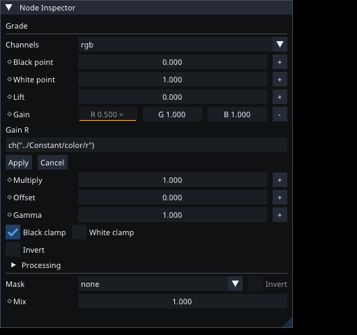
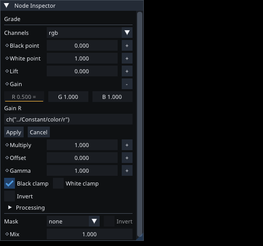

# Compositor parameter links — 10 October 2026

Numeric components, Mix and shader controls support direct references and bounded
expressions within a compositor document. Native channel records store the shared
`Binding`/`Expr` model. There is one evaluation path for render compilation and
public parameter sampling; transform motion blur samples bindings at each exact
shutter time. Graph preparation validates targets, scalar types and cycles, and
indexes parameter addresses. Evaluation is bounded and memoizes dependencies.

Component menus expose Copy Parameter, Paste Relative Reference, Edit Expression,
Go to Source and Remove Reference. Driven samples remain in the compact numeric
row, with a trailing `=`; neighboring components remain editable. Expression
fields omit identity annotations while retaining existing reference metadata.
Invalid drafts and action errors remain visible. Removing a reference holds the
sampled value. Changes use the existing preview/commit/cancel and undo lifecycle.
Shader interface migration remaps referenced components and rejects deleting a
referenced control. Duplicate nodes remap their internal references.

Removed parameter tooltips from shared animated/color/curve controls, compositor
controls and Motion parameter inspectors, plus node and socket hover tooltips in
the shared graph editor. Toolbar action help outside parameter/node controls is
unchanged. Future parameter/node tooltips require an explicit artist request.

## Verification

- Desktop application and affected targets checked. Final optimized desktop build
  completed successfully. The existing running instance was left open.
- Focused compositor reference tests exercise public author edits, rendered animated
  dependencies, rename, serialization/reopen, undo, missing targets, cycles,
  protection, self-link duplication, runtime errors and shader interface migration.
- Existing compositor animation, reusable effect and native inspector tests pass.
- Shared property interaction tests pass. Shared expression display/edge metadata
  test passes.
- Native ImGui captures at 420 px and 280 px were visually reviewed. Driven values,
  editable neighboring components and the expression editor fit both widths.
  Captures use the actual UI renderer on llvmpipe Vulkan; physical artist acceptance
  remains unverified.
- An existing standalone `fold-graph` quaternion canonical-roundtrip test fails
  on a one-ULP float difference. The identical failure was reproduced with the
  unchanged HEAD expression source. It is outside this scalar binding change.

## Remaining scope

This slice covers numeric components inside one compositor document. It does not
complete M5c cross-document/provider binding, boolean/enum configuration expressions,
or universal instance editing. Compositor WGSL Shader scripting and Motion Rhai
Wrangle remain their existing separate capabilities. No full workspace test or
Clippy checkpoint is claimed here.
