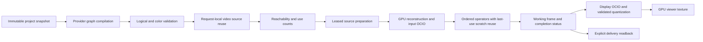

# Compositor/render pipeline audit — 10 October 2026

User-directed rendering follow-up. This does not qualify Motion M6 or close the
existing native artist/export acceptance gates. No project schema, UI, authoring
operation, color policy, decoder fallback policy or dependency version changes.

## Ownership and data flow



Compositor owns native records, animation and channel interpretation. Render owns
the feature-neutral IR, CPU reference and physical execution; App workers own
preview/export orchestration. Provider fragments append image work without
rendering intermediate movies. There is no new feature model inside Render.

### Findings and changes

| Area | Audit result |
| --- | --- |
| Repeated video reads | Separate provider/read fragments repeated YUV reconstruction, input OCIO and resampling despite sharing decoded planes. Both CPU and GPU now canonicalize equivalent reads after complete validation and before dependency planning. Keys include path, content fingerprint, source metadata, exact sampled frame, color assignment, output size and region. Logical records stay intact; no persistent cache or weaker invalidation rule was introduced. |
| Working color conversion | OCIO wrote a float intermediate; validation copied it into another full-size float texture. Working conversions now write their destination directly and validate it read-only. This removes one RGBA32F write and the intermediate allocation (33,177,600 bytes at 1080p) per conversion. It does **not** remove validation or count it as a removed compute pass. |
| Display conversion | Float intermediate retained: values must be checked before RGBA8 UNORM storage hides overflow/invalid values. Signed/HDR working RGB and premultiplied alpha are preserved; no reduced precision or sampled OCIO approximation. |
| Shader input lifetimes | Generic three-slot binding logic also retired shader dependencies, although shaders support eight images. Inputs four through eight remained live until submission end, causing avoidable allocation pressure. Retirement now enumerates all actual dependencies and retains the opacity-fusion substitution. A five-group/four-input shader regression demonstrates failure before and success after. |
| Source files | First use creates a verified immutable file pin; existing pins are shared. This intentional disk copy protects rendering from linked-file mutation. It is not repeated per frame. |
| Decoded CPU data | Native planar FFmpeg output transfers its `Vec` into immutable `YuvFrame` storage; clones retain shared storage. No full-frame CPU RGBA reconstruction is needed for these ACES video paths. ProRes still uses CPU decoding and uploads native planes. |
| Hardware decode | NVDEC copies into engine-owned storage so renderer consumers do not hold scarce decoder surfaces. That GPU-local copy is intentional, counted, and not described as zero-copy. The initially available helper runtime only enabled H.264. Rebuilding the existing pinned-runtime script with cached source archives enabled HEVC; no implicit CPU fallback was added. |
| Scratch and synchronization | GPU images are reused only after their last encoded dependency; across submissions Host completion callbacks and leases protect reuse. Cached immutable inputs do not become mutable scratch. CPU reference counts alone do not signal GPU completion. |
| Upload ordering | Image staging uses encoded copies; replacing these with queue writes could overwrite reused scratch before earlier passes execute. Queue writes remain appropriate for immutable/new resources and LUTs. |
| Submission | Ordinary graph operators share an encoder/submission; output conversion is a separate ordered submission without a CPU wait between scene and display. Native interop and native-resolution windowed sources have explicit additional boundaries. No per-node queue submit or global queue-idle wait was added. |
| Preview/output | Preview publishes a GPU texture. Only completion/validation/timestamp bytes return to CPU. Explicit capture and current FFmpeg delivery read pixels back. Export never consumes the lossy viewer cache. |
| Allocation | Full-frame textures, stills, decoded inputs, pipelines and upload buffers have bounded retention. Per-pass uniforms/bind groups and new immutable video buffers still incur allocation work. Raw Vulkan memory/command-pool policy belongs to wgpu; bypassing it is not justified by this audit. |

### Remaining costs and limits

- This is not a universal graph optimizer. Operations, masks, channel packing,
  separable filters and genuinely distinct source times/color interpretations
  retain their work. Cross-request video working-image caching was not added;
  viewer presentation caching already handles a different, explicitly lossy role.
- Compositor document preparation still occurs per compile. Motion's broader
  dependency-cache/fusion work remains gated by the rewrite plan.
- Alpha video delivery currently reads scene float pixels and performs output
  conversion/packing on CPU. MP4 delivery also packs RGBA into RGB for its FFmpeg
  pipe. GPU encoder interop and alpha-delivery optimization remain separate work;
  these paths are not represented by the frame-ready benchmark below.
- Buffer allocation, decoder/helper call intervals, device copy timestamps and
  physical driver memory are different quantities. Host logical accounting is
  not a total VRAM/RSS measurement. Queue submission times are CPU intervals.
- Native-window presentation, input latency, sustained playback/drop behavior,
  concurrent export fairness and other GPU vendors are not qualified here.

## Vulkan/wgpu review

Pinned implementation: wgpu **27.0.1**, wgpu-core **27.0.3**, wgpu-hal **27.0.4**,
Naga **27.0.3**, OCIO **2.4.2**. The local pinned wgpu `api/queue.rs` explicitly
states that queue writes execute before the next submitted command buffers and
that staging can incur allocations. Reviewed against the official
[Queue documentation](https://wgpu.rs/doc/wgpu/struct.Queue.html) (current online
version differs; local pinned source governs this implementation).

The changes reduce unnecessary image traffic and preserve leased device-local
resources, consistent with Khronos's
[memory allocation/transfer guidance](https://docs.vulkan.org/guide/latest/memory_allocation.html).
The existing batched graph encoder avoids fragmented submissions; wgpu owns
command-pool recycling and barriers. Khronos's
[command-buffer guidance](https://docs.vulkan.org/samples/latest/samples/performance/command_buffer_usage/README.html)
also supports measuring release builds and avoiding excessive small buffers.
No raw-Vulkan flags, ad hoc barriers, unsafe interop changes, or speculative
parallel queues were introduced.

## Measurement protocol

`render_profile` now probes actual dimensions, duration and rational frame rate;
the old fixed 1920×1080/25 fps fixture repeated/skipped source frames for these
24 fps clips. Statistics and GPU timestamps now include display conversion;
scene-only GPU time is reported separately. Evaluation CPU time includes source
preparation and is not added to decode time as if those were disjoint phases.
It also supports shared reads, deterministic random/reverse sampling and held
frames. Compile, decode, output CPU, submission CPU, transfer bytes, passes and
logical memory are recorded separately.

Sources (originals untouched):

- `~/Videos/Create-one-continuous-feeling-15-second.mp4`: 1920×1080, 24/1,
  361 frames, HEVC `yuv420p10le`.
- `~/Videos/Cutdown_02_VFX_v01.mov`: 1920×1080, 24/1, 360 frames,
  ProRes `yuva444p12le`.

Hardware: Intel i7-8750H, NVIDIA GTX 1070 (8 GiB), driver 580.173.02, Vulkan. Working format is
RGBA32F with ACEScg, `sRGB - Display` / `ACES 1.0 - SDR Video`, no look. Blur size is
[8,8]; full graph adds transform, ellipse mask and grade. The shared fixture
appends two source fragments and composites them. There is no presentation-cache
hit, resolution reduction, dropped frame or source transcoding in the throughput
measurement.

Three independent processes per version/clip/stage, 90 forward samples each;
first frame reported separately and first ten excluded from warm percentiles
(240 warm samples). A/B process order alternates between trials. First-frame
latency includes lazy color pipelines and decode preparation, but excludes
adapter/renderer creation and asset ingest. OS file caches are not flushed.
Raw frame timing includes readiness polling; GPU timestamp intervals isolate
scene/display work. Verification readback and CPU references run separately.
The video-upload counter excludes small generic parameter-buffer initialization;
zero video upload is not a claim that no CPU parameter bytes reach the GPU.


## Paired release measurements

Each cell is **before → after**. GPU time includes display conversion. Peak is
logical Host allocation, including retained caches, not driver VRAM.

| Clip / graph | Warm wall P50 ms | Warm wall P95 ms | GPU P50 ms | Peak MiB | Passes |
| --- | ---: | ---: | ---: | ---: | ---: |
| HEVC / source | 11.04 → 10.81 | 13.19 → 12.71 | 2.00 → 1.82 | 193.80 → 162.16 | 5 → 5 |
| HEVC / shared | 12.73 → 11.05 | 14.74 → 12.58 | 3.69 → 2.15 | 225.44 → 162.16 | 9 → 6 |
| HEVC / blur | 12.96 → 12.78 | 15.43 → 14.92 | 3.67 → 3.50 | 193.80 → 193.80 | 7 → 7 |
| HEVC / full | 20.75 → 20.58 | 28.07 → 26.66 | 10.62 → 10.44 | 225.58 → 225.58 | 15 → 15 |
| PRORES / source | 23.29 → 23.76 | 28.75 → 29.81 | 2.35 → 3.10 | 197.75 → 166.11 | 5 → 5 |
| PRORES / shared | 24.55 → 23.73 | 30.62 → 29.05 | 4.18 → 2.94 | 229.40 → 166.11 | 9 → 6 |
| PRORES / blur | 26.30 → 25.82 | 31.78 → 33.03 | 4.66 → 4.38 | 197.76 → 197.76 | 7 → 7 |
| PRORES / full | 32.18 → 31.43 | 38.01 → 37.02 | 10.60 → 10.29 | 229.53 → 229.53 | 15 → 15 |

The shared fixture reduces GPU P50 by **41.6% HEVC / 29.7% ProRes**, wall P50
by **13.2% / 3.3%**, and peak logical allocation by **63.28 MiB** on both.
Source-only peak falls **31.64 MiB**. Blur/full scratch requirements keep their
peaks unchanged; their input conversion still avoids the extra float write.

The ProRes source-only result is a real limitation of the paired measurement:
GPU P50 rises 2.35 → 3.10 ms and wall P50 rises 23.29 → 23.76 ms. Do not
claim every workload becomes faster. Clock-state follow-up is recorded below.

Every measured preview has zero image readback; status/timestamp readback is
48 bytes/frame. HEVC uses a 6,220,800-byte GPU-local decode copy and zero video
upload/pipe bytes. ProRes uploads 16,588,800 bytes of native planes per new frame;
source deduplication saves reconstruction/conversion, not an already-shared upload.

Full percentiles, cold-frame values and transfer counts: [summary](summary.json).
The paired executable preceded a final host-only cleanup replacing a temporary
color-binding vector with a stack array. Shaders, graph planning and lifetimes
are identical; final-build verification and clock probes exercise the cleanup.

## Clock-state follow-up on the final build

Four additional 180-frame ProRes source runs (before/after/after/before), with
read-only NVML sampling at 100 ms intervals:

| Run | GPU P50 ms | Unchanged display P50 ms | Wall P50 ms | Observed active graphics / memory clocks |
| --- | ---: | ---: | ---: | --- |
| Before 0 | 3.236 | 1.315 | 24.275 | 873–987 MHz / 810–4006 MHz, P0/P3/P5 |
| After 1 | 2.194 | 0.977 | 23.004 | 1442 MHz / 4006 MHz, P0 |
| After 2 | 2.851 | 1.318 | 23.779 | 873–961 MHz / 2999–3802 MHz, P2/P3 |
| Before 3 | 3.217 | 1.366 | 23.973 | 961 MHz / 2999 MHz, P3 |

Active windows are approximate: reconstructed from the last output timestamp and
warm frame durations, excluding the first ten frames. These observations support
clock-state sensitivity, including in the unchanged display pass; they do not
establish a controlled fixed-clock speedup. The original unfavorable source-only
measurement remains in the table. No GPU clocks or power policies were changed.
See [clock samples](gpu-clocks.csv), [clock frame timings](clock-frames.jsonl.gz)
and [probe](clock_probe.py).

## Validation and reproducibility

- Release native-video example builds successfully with locked dependencies.
- `cargo test --locked -j 2 -p fold-render --features native-video --lib --tests -- --test-threads=1`:
  **89 passed**, **51 ignored**. [Log](render-tests.log).
- **11 selected native Vulkan checks pass**: two color allocation/overflow checks,
  three submission cancellation/device-loss/admission checks, three existing
  operator/HDR/capture checks, the new four-input shader lifetime check, and two
  OCIO/video checks. Shared alpha-video reuse is checked at both native and half
  resolution, with linear CPU/GPU tolerance `0.0001` unchanged. Logs:
  [color](color-after-final.log), [submission](submission.log), [operators](gpu.log),
  [shader](shader-after.log), [OCIO/video](gpu-color-final.log).
- The allocation regressions were demonstrated before their fixes:
  [working color](color-before-test.log), [shader inputs](shader-before.log).
- `cargo test -p fold-compositor --lib --tests` reached **42 passes / one inherited
  failure** before stopping: `native_authoring` expects 24 operators at line 173,
  while the unchanged registry contains 25. The same assertion exists in HEAD;
  neither file was edited. The remainder of that suite is not claimed as run.
  [Log](compositor-tests.log).
- Clippy completes with seven existing Render warnings and five existing Media
  warnings; no warning in changed code remains. [Log](clippy-final.log).
- Workspace format check, diff whitespace check and package/headless boundary
  check pass. [Boundaries](boundaries.log). No full workspace or physical desktop
  acceptance claim is made for this focused follow-up.

[Provenance](provenance.json) records source hashes, base commit, compiler, host
CPU/kernel, software FFmpeg, native-runtime build flags and binary/configuration
hashes. The old H.264-only helper binary was reused with newly built, same-ABI
FFmpeg 6.1.1 HEVC/NVDEC libraries; both binary and runtime identities are recorded.
The original clips were neither modified nor transcoded.

The paired runner and summarizer are retained as the scripts actually used:
[runner](benchmark.py), [summarizer](summarize.py). They expect the recorded local
`/tmp/fold-render-audit` fixtures/binaries. [All 4,320 paired frame records](frames.jsonl.gz)
retain timing, transfer and allocation counters; the evidence does not depend on
only the selected medians above.

Example final-build reproduction from repository root:

```sh
cargo build --locked --release -j 2 -p fold-app --features native-video --example render_profile
FOLD_COLOR_ROOT="$PWD/target" \
FOLD_VIDEO_HELPER=/tmp/fold-render-audit/video-runtime/bin/fold-video-helper \
FOLD_VIDEO_DECODER=cuda-native \
target/release/examples/render_profile "$HOME/Videos/Cutdown_02_VFX_v01.mov" 90 8 shared
```

Use the existing `scripts/build_video_runtime.py` to recreate the pinned runtime
if that scratch directory is absent; package the helper against its declared ABI.
`FOLD_PROFILE_VERIFY=1` checks the first requested sample against CPU output
(maximum one RGBA8 code difference) and compares matched preview/delivery bytes.

Final-build real-clip verification: **12 scenarios passed**, including all **361
HEVC / 360 ProRes frames** in forward full-effects traversal, 90-frame reverse
and deterministic random shared-source sequences, and 30 held shared-source
requests per clip. Each scenario compares its **first requested sample** against
CPU output (maximum one RGBA8 code) and requires byte-identical matched preview/
delivery output. Remaining frames check GPU completion/invalid-value status;
this is not an all-frame CPU pixel comparison or encoded-export/desktop test.
[Per-scenario evidence](verification.json), [runner](verify.py),
[completion log](verify-progress.log).
